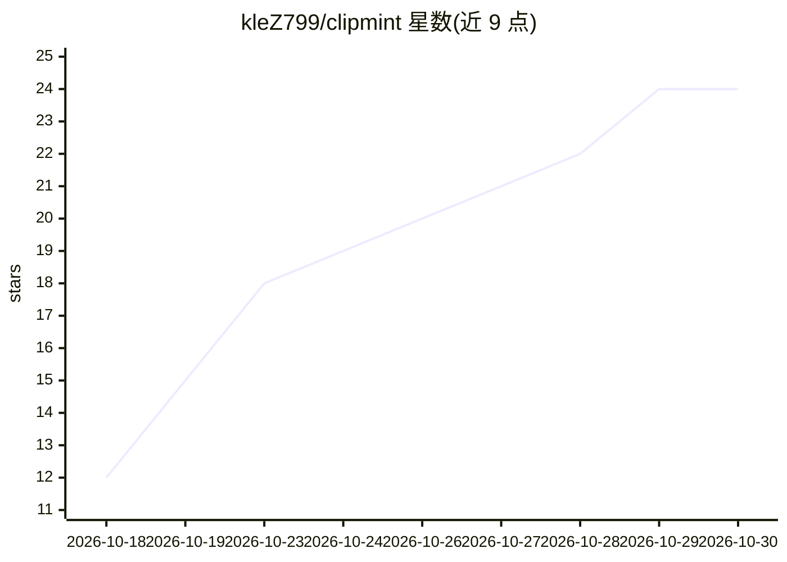

# kleZ799/clipmint

⭐ 24 · Python · MIT · 推送 2026-10-05 · [GitHub](https://github.com/kleZ799/clipmint) · [官网](https://klez799.github.io/clipmint/) · 个人维护

**本地运行的长视频转竖屏短视频 AI 剪辑生成器**

面向内容创作者的桌面应用：读取播客、vlog、教程、直播录像等长视频，本地 faster-whisper 转录音频，按视频类型规则排序精彩片段，裁切为 9:16 并逐词烧录字幕、剪除停顿、生成标题与标签，可直接或定时上传 YouTube。提供自然语言式排版指令、说话人跟踪裁剪、LLM 排序的 Gemini→Groq→OpenAI 回退链。Windows 为已测试构建，Mac/Linux 构建未经真机验证；单文件可执行、自更新、免订阅无水印。

## 筛选速览

| 维度 | 判定 | 备注 |
|---|---|---|
| AI 角色 | `ai-native` | 本体是模型或模型工具 |
| 许可风险 | `permissive` | MIT |
| 部署形态 | `desktop` | 安装包/桌面程序 |
| 模型依赖 | locked-api |  |
| 硬件要求 | `cpu-ok` | |
| 安装摩擦 | `medium` | 含编译或系统依赖之一 |
| 成熟度 | `idea` | |

## 能力要点

- 本地 faster-whisper 转录，视频默认不上传
- LLM 排序带回退链（Gemini→Groq→OpenAI）
- 逐词字幕烧录与说话人跟踪裁剪
- 片段评分拆解（Hook/Moment/Look/Energy/Pace）并说明排序理由

## 适用场景

- 把播客或直播录像自动切成 YouTube Shorts / Reels / TikTok 竖屏片段
- 用一句话指令控制画面布局与剪辑要求
- 定时将生成的片段发布到自己的 YouTube 频道

## 场景标签

`图像视频处理` · 领域:感知与多模态

## 证据(README 行号)

> L133: Transcribes the audio locally with faster-whisper, then ranks every moment for
> L112: **Gemini → Groq → OpenAI**, free before paid, switching on a spent quota *or* on
> L5: A free, open-source AI clip generator for podcasts, interviews, vlogs,

## 星数曲线

2026-10-18 12 → 2026-10-30 24（+12）

---
*卡片 v1 · prompt 1.4 · 生成 2026-10-28 · 置信度 mid · 依据 README sha `05afadff844b` · [字段定义](../../DATASET.md)*
