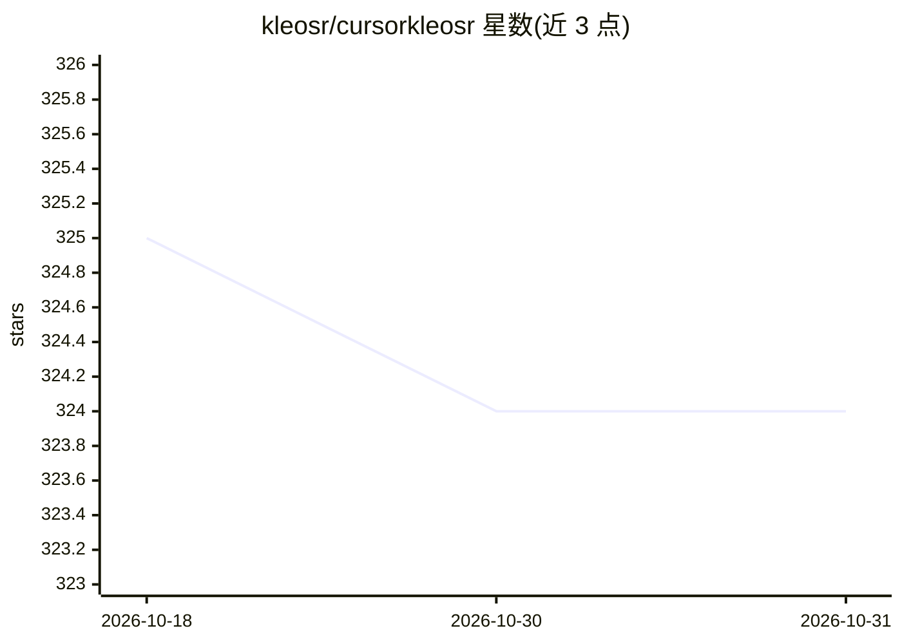

# kleosr/cursorkleosr

⭐ 324 · NOASSERTION · 推送 2026-10-06 · [GitHub](https://github.com/kleosr/cursorkleosr) · [官网](https://forum.cursor.com/t/guide-a-simpler-more-autonomous-ai-workflow-for-cursor/70688) · 个人维护

**Cursor 常驻规则+Markdown 状态文件实现的 agent 记忆方案**

面向 Cursor 用户的 agent 记忆模板项目：由一个 alwaysApply 的 Cursor 规则（.cursor/rules/workflow-memory.mdc）在每个会话自动注入操作循环，配合仓库根目录的 workflow_state.md（阶段/计划/阻塞/日志）与 project_config.md（目标/技术栈/约束）等 Markdown 文件，使 agent 会话开始即读取项目状态、完成工作后写回。工作流为 ANALYZE→PREPARE→IMPLEMENT→VALIDATE 循环。零依赖、无构建步骤，纯文档型项目，无测试与 CI。

## 筛选速览

| 维度 | 判定 | 备注 |
|---|---|---|
| AI 角色 | `ai-ecosystem` | LLM/agent 周边工具 |
| 许可风险 | `none` | NOASSERTION |
| 部署形态 | `None` |  |
| 模型依赖 | — | README 未给出锁定关系 |
| 硬件要求 | — | 无带数字的原话,不猜 |
| 安装摩擦 | `low` | 无编译、无系统依赖或容器化 |
| 成熟度 | — | 结构信号不足 |

## 能力要点

- alwaysApply 的 Cursor 规则在每个 agent 会话自动注入操作循环
- 状态以根目录 Markdown 文件承载，可 diff、可 grep
- read→act→write 的四阶段工作流循环
- 零依赖、无构建、无数据库

## 适用场景

- 让 Cursor 中的 agent 跨会话记住项目状态
- 以纯 Markdown 维护项目目标与技术栈上下文
- 在任意编辑器/终端查看与回溯 agent 工作日志

## 场景标签

`Agent 记忆` · 领域:Agent 开发

## 证据(README 行号)

> L2:  Agent memory that cannot be forgotten — one always-on Cursor rule plus root markdown state.
> L9: `.cursor/rules/workflow-memory.mdc` ships with `alwaysApply: true`, so Cursor injects the operating loop into every 

## 星数曲线

2026-10-18 325 → 2026-10-31 324（-1）

---
*卡片 v1 · prompt 1.4 · 生成 2026-10-21 · 置信度 high · 依据 README sha `4903acffe0df` · [字段定义](../../DATASET.md)*
