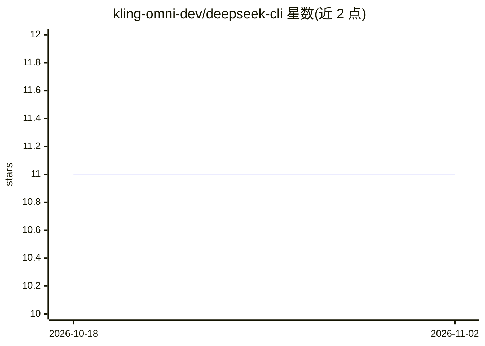

# kling-omni-dev/deepseek-cli

⭐ 11 · 推送 2026-09-22 · [GitHub](https://github.com/kling-omni-dev/deepseek-cli) · [官网](https://begin.sh?utm_source=github&utm_medium=ugc&utm_campaign=deepseek-cli&utm_content=readme-top&utm_term=tier-r) · 个人维护

**DeepSeek CLI（Deep Code）的非官方使用指南文档**

社区撰写的非官方指南，介绍开源终端 AI 编程助手 Deep Code 的安装与配置：npm 全局安装、settings.json 配置（BASE_URL/API_KEY/thinkingEnabled/reasoningEffort）、deepseek-v4-pro 与 deepseek-v4-flash 模型选项、Agent Skills 的 Markdown 文件位置、快捷键与 notify/webSearchTool 等实用项，并附与 VS Code 扩展及 Begin.sh 的功能对比表。指南声明与 DeepSeek 及 Deep Code 维护者无隶属关系，覆盖官方集成页未说明的细节（如明文 API key 风险）。

## 筛选速览

| 维度 | 判定 | 备注 |
|---|---|---|
| AI 角色 | `ai-knowledge` | 知识聚合/清单类 |
| 许可风险 | `none` | — |
| 部署形态 | `library` | 以包/库形式分发 |
| 模型依赖 | — | README 未给出锁定关系 |
| 硬件要求 | — | 无带数字的原话,不猜 |
| 安装摩擦 | `low` | 无编译、无系统依赖或容器化 |
| 成熟度 | — | 结构信号不足 |

## 能力要点

- 覆盖安装、settings.json 配置、模型选项与 reasoningEffort 成本控制说明
- 记录 Agent Skills 的用户级与项目级文件路径及调用方式
- 提供 Deep Code CLI / VS Code 扩展 / Begin.sh 三方对比表
- 指出 API key 明文存放等官方文档未覆盖的实践注意事项

## 适用场景

- 上手安装并配置 DeepSeek CLI 连接 DeepSeek API
- 调整 thinkingEnabled 与 reasoningEffort 控制使用成本
- 编写和团队共享 Agent Skills 文件

## 场景标签

`教程课程` · 领域:学习与行业

## 证据(README 行号)

> L3: *Unofficial community guide for DeepSeek CLI (Deep Code). Not affiliated with DeepSeek. All trademarks belong to the
> L5: When people search for a deepseek cli they usually mean Deep Code: the open-source terminal coding assistant that th

## 星数曲线

2026-10-18 11 → 2026-11-02 11（+0）

---
*卡片 v1 · prompt 1.4 · 生成 2026-11-02 · 置信度 mid · 依据 README sha `6e9fd8dcc2c6` · [字段定义](../../DATASET.md)*
