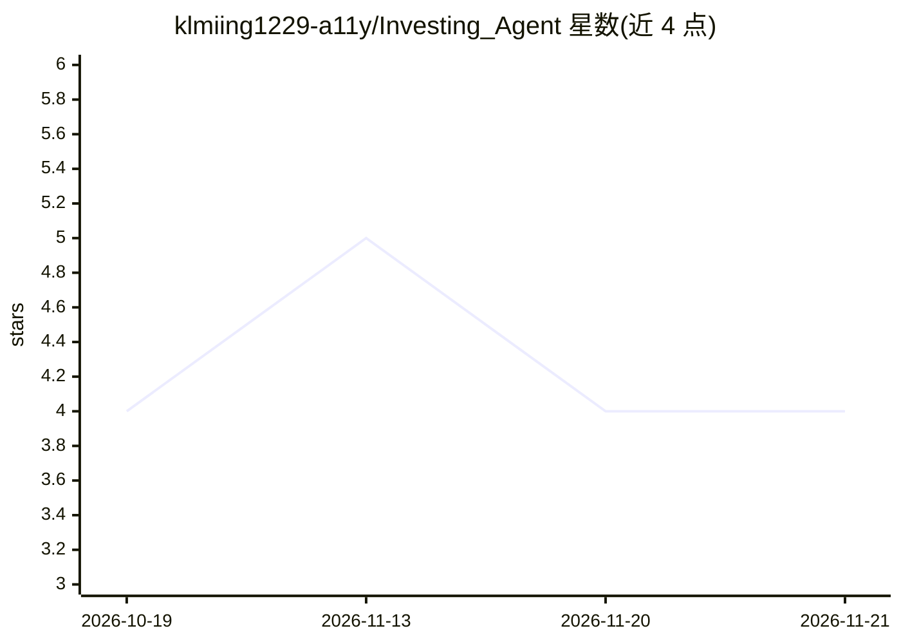

# klmiing1229-a11y/Investing_Agent

⭐ 4 · Python · MIT · 推送 2026-10-16 · [GitHub](https://github.com/klmiing1229-a11y/Investing_Agent) · 个人维护

**给个人投资者的量化分析 Agent：14 技术面+9 基本面打分给出倾向**

以技能/提示词形式分发的投资分析 agent：按固定公式对 14 条技术线与 9 条基本面线打分，输出 Buy lean/Hold/Sell lean/No edge 四档倾向与 Low/Medium/High 信心度，每条规则标注出处（自建 R- 规则或 W- 已发表研究）。支持三种运行路径：Claude Code 加 Longbridge MCP 取实时数据、Python 脚本取 Yahoo 数据或读 CSV、无工具聊天 AI 手填数据。不下单、不给目标价，附 15 主题量化教学课程与 LEARN 自定义规则机制。

## 筛选速览

| 维度 | 判定 | 备注 |
|---|---|---|
| AI 角色 | `ai-knowledge` | 知识聚合/清单类 |
| 许可风险 | `permissive` | MIT |
| 部署形态 | `None` |  |
| 模型依赖 | — | README 未给出锁定关系 |
| 硬件要求 | — | 无带数字的原话,不猜 |
| 安装摩擦 | `low` | 无编译、无系统依赖或容器化 |
| 成熟度 | — | 结构信号不足 |

## 能力要点

- 14 技术线 + 9 基本面线的固定公式打分，同图同答案
- 每条规则引用已发表研究，来源在 RESEARCH.md
- 三种运行路径：MCP 实时数据 / Python 脚本 / 纯聊天提示词
- 15 主题量化课程与 LEARN 模式自定义规则

## 适用场景

- 用统一框架问某只股票当前该买还是该持有
- 只用聊天 AI 无工具时按清单手填数据做分析
- 按 15 主题课程学量化交易基础
- 回看历史判断记录检验倾向命中率

## 场景标签

`金融量化` `教程课程` · 领域:学习与行业

## 证据(README 行号)

> L5: Ask "is it a good time to buy NVDA?" and get the evidence instead of a guess. The agent works like
> L47: |**B. Any AI that can run Python** (Claude Code, Codex, Cursor, ChatGPT with code)|`tools/indicators.py` fetches 2 
> L119: PROMPT.md               the whole method, for any AI

## 星数曲线

2026-10-19 4 → 2026-11-21 4（+0）

---
*卡片 v1 · prompt 1.4 · 生成 2026-11-21 · 置信度 high · 依据 README sha `dcb73b949e4c` · [字段定义](../../DATASET.md)*
