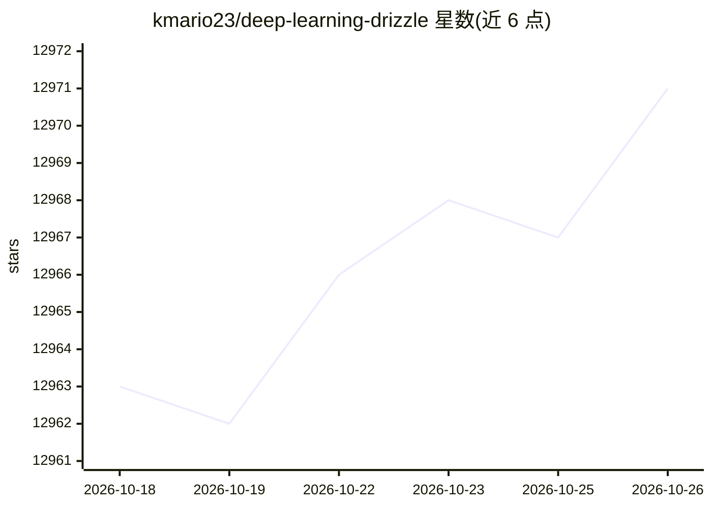

# kmario23/deep-learning-drizzle

⭐ 12,971 · HTML · 推送 2026-08-22 · [GitHub](https://github.com/kmario23/deep-learning-drizzle) · [官网](https://deep-learning-drizzle.github.io) · 个人维护

**深度学习/机器学习公开课程与讲座视频的策展清单**

按主题分类汇总各高校与机构深度学习课程的链接清单：每个条目包含课程名、授课教师与院校、课程主页、讲座视频（多为 YouTube 链接，部分提供 Academic Torrent）及年份。可见部分覆盖 Deep Neural Networks 与 Machine Learning Fundamentals 板块，收录 81 门深度学习相关课程，涉及 Stanford、MIT、CMU、NYU、DeepMind 等来源，年份跨度 2012-2022。仓库本身不含代码或模型，仅为只读的课程资源索引，无需安装。

## 筛选速览

| 维度 | 判定 | 备注 |
|---|---|---|
| AI 角色 | `ai-knowledge` | 知识聚合/清单类 |
| 许可风险 | `none` | — |
| 部署形态 | `None` |  |
| 模型依赖 | — | README 未给出锁定关系 |
| 硬件要求 | — | 无带数字的原话,不猜 |
| 安装摩擦 | `low` | 无编译、无系统依赖或容器化 |
| 成熟度 | — | 结构信号不足 |

## 能力要点

- 按主题板块组织的课程清单，条目含院校/教师/主页/视频/年份字段
- 可见部分收录 81 门深度学习课程（2012-2022）
- 部分课程提供 Academic Torrent 或独立 Lecture-Videos 链接

## 适用场景

- 按院校或年份查找深度学习入门与进阶课程
- 为自学路线收集视频讲座与配套课程主页
- 比较不同机构同类课程的开设情况

## 场景标签

`教程课程` `精选清单` · 领域:学习与行业

## 证据(README 行号)

> L9: ## :tada: Deep Learning (Deep Neural Networks) :confetti_ball: :balloon:
> L108: ### :cupid: Machine Learning Fundamentals :cyclone: :boom:

## 星数曲线

2026-10-18 12,963 → 2026-10-26 12,971（+8）

---
*卡片 v1 · prompt 1.4 · 生成 2026-10-20 · 置信度 high · 依据 README sha `74ea380ffdf0` · [字段定义](../../DATASET.md)*
