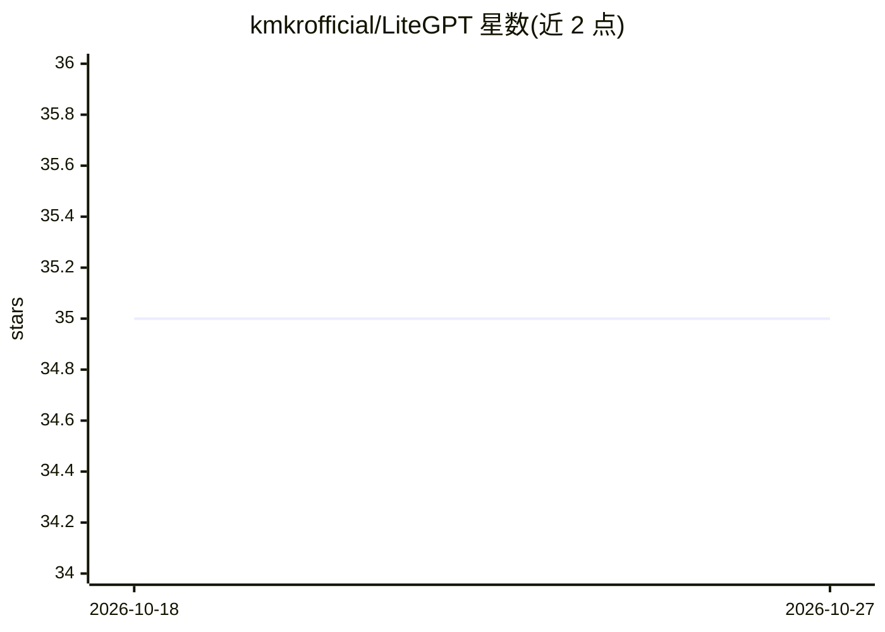

# kmkrofficial/LiteGPT

⭐ 35 · Python · 推送 2026-10-05 · [GitHub](https://github.com/kmkrofficial/LiteGPT) · 个人维护

**基于 nanoGPT 从零训练的 124M 小语言模型及代码**

基于 Andrej Karpathy 的 nanoGPT 框架，从零训练 GPT-2 Small 等价（12 层、12 头、768 维）的 124M 参数小语言模型：在 FineWeb-Edu 10B token 样本上预训练，再用 Alpaca 数据集做指令微调。仓库提供数据准备脚本、训练与微调配置、交互式推理脚本（check_model.py / check_instruct.py），以及将 checkpoint 导出至 Hugging Face Hub 的脚本；模型托管为 koganrath/LiteGPT-Instruct 与 LiteGPT-Base，可用 transformers 的 GPT2LMHeadModel 加载。数据集不随仓库分发，需自行下载准备。测试环境为 Windows、Python 3.11.9。

## 筛选速览

| 维度 | 判定 | 备注 |
|---|---|---|
| AI 角色 | `ai-native` | 本体是模型或模型工具 |
| 许可风险 | `none` | — |
| 部署形态 | `library` | 以包/库形式分发 |
| 模型依赖 | — | README 未给出锁定关系 |
| 硬件要求 | — | 无带数字的原话,不猜 |
| 安装摩擦 | `low` | 无编译、无系统依赖或容器化 |
| 成熟度 | — | 结构信号不足 |

## 能力要点

- GPT-2 Small（124M）架构，FineWeb-Edu 预训练 + Alpaca 指令微调
- 提供训练、微调与交互式推理脚本（支持 /temp、/tokens 命令）
- checkpoint 可导出至 Hugging Face Hub，模型已托管两个版本
- hugging_face_inference/ 目录提供独立推理环境

## 适用场景

- 学习从零训练小语言模型的完整流程
- 在自有教育数据上复现或改训 GPT-2 级模型
- 通过 transformers 加载已托管模型做指令对话推理

## 场景标签

`模型训练` `微调` · 领域:训练与推理

## 证据(README 行号)

> L5: The goal of this project is to build a GPT-2 (124M parameter) equivalent model trained on high-quality educational d
> L37: python train.py config/finetune_alpaca.py

## 星数曲线

2026-10-18 35 → 2026-10-27 35（+0）

---
*卡片 v1 · prompt 1.4 · 生成 2026-10-25 · 置信度 high · 依据 README sha `fd716ee5b724` · [字段定义](../../DATASET.md)*
