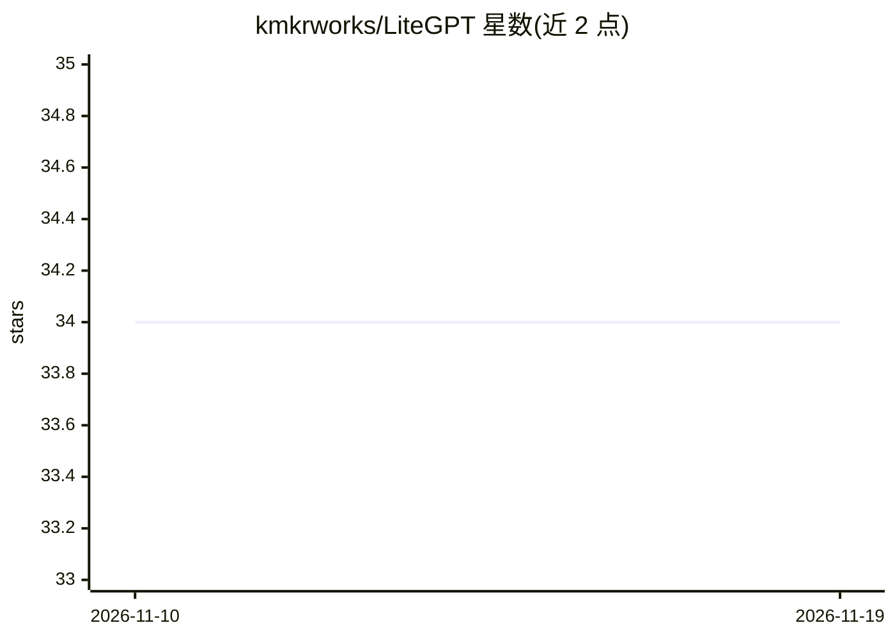

# kmkrworks/LiteGPT

⭐ 34 · Python · MIT · 推送 2026-11-10 · [GitHub](https://github.com/kmkrworks/LiteGPT) · 个人维护

**201M 参数的开源小语言模型及完整训练管线**

LiteGPT V2 是从零实现的 201M 参数语言模型：自带架构实现（RoPE、RMSNorm、SwiGLU、分组查询注意力，28 层×768）、自训 32,768 词元 BPE 分词器与自有权重，4,096 token 上下文。设计在 RTX 4090 笔记本 GPU 完成，预训练在租用 A100 上进行 37 小时。提供 Base、Instruct 及 GGUF 版本，可在 llama.cpp/LM Studio 运行，也可用 Hugging Face Transformers 加载，附带离线 Python API 与命令行。所有数据集修订、决策与结果记录随仓库公开。

## 筛选速览

| 维度 | 判定 | 备注 |
|---|---|---|
| AI 角色 | `ai-native` | 本体是模型或模型工具 |
| 许可风险 | `permissive` | MIT |
| 部署形态 | `None` |  |
| 模型依赖 | local-ok | 支持本地模型 |
| 硬件要求 | — | 无带数字的原话,不猜 |
| 安装摩擦 | `low` | 无编译、无系统依赖或容器化 |
| 成熟度 | — | 结构信号不足 |

## 能力要点

- 架构、分词器、训练循环、评测与发布工具全部自建
- Q8_0 文件 215 MB，在 4 个笔记本 CPU 线程上 189 tok/s 解码
- 微调后 Banking77 意图准确率 91.4%，99.99% MASSIVE 请求输出合法 JSON
- Transformers 加载无需远程代码

## 适用场景

- 在笔记本或纯 CPU 环境本地运行小语言模型
- 研究小模型的完整训练管线与实验记录
- 通过 llama.cpp 或 LM Studio 部署 GGUF 版本

## 场景标签

`模型训练` `微调` · 领域:训练与推理

## 证据(README 行号)

> L5: LiteGPT V2 is a 201M-parameter model with its own architecture implementation, its own trained tokenizer and its own
> L9: |LiteGPT-V2-Base|The pretrained model, 4,096-token context|

## 星数曲线

2026-11-10 34 → 2026-11-19 34（+0）

---
*卡片 v1 · prompt 1.4 · 生成 2026-11-18 · 置信度 high · 依据 README sha `7566d1741534` · [字段定义](../../DATASET.md)*
