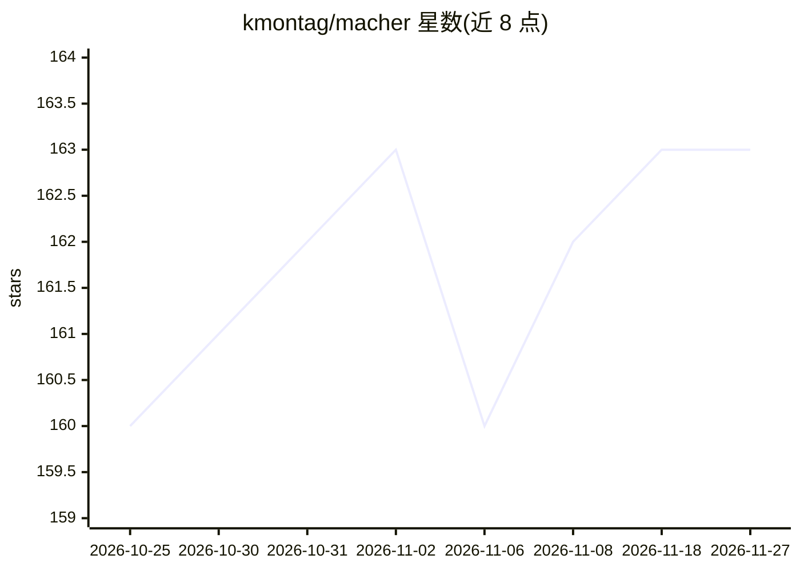

# kmontag/macher

⭐ 163 · Emacs Lisp · GPL-3.0 · 推送 2026-11-07 · [GitHub](https://github.com/kmontag/macher) · 个人维护

**Emacs 项目内多文件 LLM 编辑工具集，基于 gptel**

构建在 gptel 之上的 Emacs 包：让 LLM 在当前项目范围内读取/搜索文件并以补丁形式提出跨文件修改，改动在内存中收集、用户应用前不写盘。文件访问默认限制在 project.el 项目或单文件内，工具设计为无需逐次确认即可安全运行。提供 @macher 等预设、implement/revise/discuss 三个动作命令及可定制的工作区、系统提示注入与补丁 UI；要求使用支持 tool use 的 gptel 后端，通过 MELPA 安装。

## 筛选速览

| 维度 | 判定 | 备注 |
|---|---|---|
| AI 角色 | `ai-native` | 本体是模型或模型工具 |
| 许可风险 | `viral` | GPL-3.0 |
| 部署形态 | `None` |  |
| 模型依赖 | — | README 未给出锁定关系 |
| 硬件要求 | — | 无带数字的原话,不猜 |
| 安装摩擦 | `low` | 无编译、无系统依赖或容器化 |
| 成熟度 | — | 结构信号不足 |

## 能力要点

- LLM 以 unified diff 补丁形式提出多文件编辑，应用前不写盘
- 文件访问默认限制在 project.el 项目内，.gitignore 文件不暴露给 LLM
- 提供 8 个文件读写/搜索/编辑工具，结构参照 MCP filesystem server
- implement/revise/discuss 内置动作与 org-mode 对话 UI

## 适用场景

- 在 Emacs 中让 LLM 基于当前项目上下文生成代码修改补丁
- 研究陌生代码库时让模型只读检索与提问
- 在不使用重量级 agentic 工具时保持轻量的 LLM 编辑流程

## 场景标签

`编码 Agent` · 领域:编码与开发

## 证据(README 行号)

> L3: A project-aware LLM editing toolset for Emacs, built on gptel.
> L9: **macher** allows your LLM to read/search files in the current project, and propose edits in the

## 星数曲线

2026-10-25 160 → 2026-11-27 163（+3）

---
*卡片 v1 · prompt 1.4 · 生成 2026-11-27 · 置信度 high · 依据 README sha `6f7a19f2bed5` · [字段定义](../../DATASET.md)*
