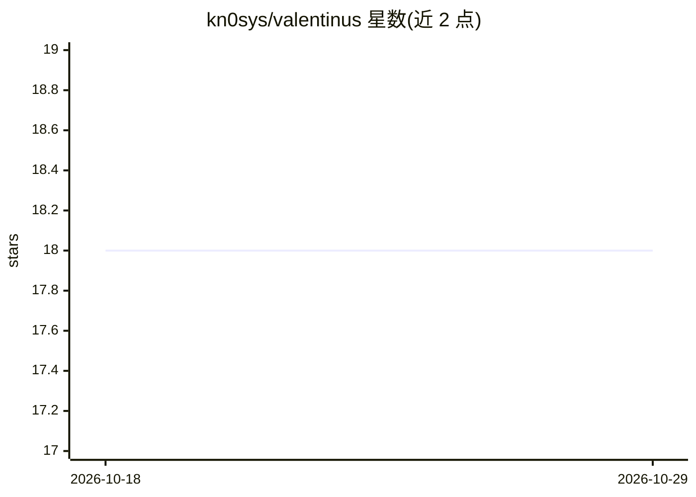

# kn0sys/valentinus

⭐ 18 · Rust · Apache-2.0 · 推送 2026-08-17 · [GitHub](https://github.com/kn0sys/valentinus) · [官网](https://docs.rs/valentinus) · 个人维护

**嵌入 LMDB 的线程安全向量数据库，支持 ONNX 模型推理**

用 Rust 编写的向量数据库，将向量存储与模型推理嵌入 LMDB：依赖 ort/onnx 生成 embeddings，ndarray 做数值运算，wincode/serde 序列化，lmdb-rs 提供数据库绑定。面向需要在进程内做向量检索的开发者，提供可选环境变量控制 LMDB 映射大小、ONNX 并行线程数与自定义 embedding 维度。构建需安装 openssl-devel、gcc-c++ 等开发包；测试需从 Hugging Face 获取 all-MiniLM-L6-v2 的 ONNX 模型与 tokenizer。

## 筛选速览

| 维度 | 判定 | 备注 |
|---|---|---|
| AI 角色 | `ai-ecosystem` | LLM/agent 周边工具 |
| 许可风险 | `permissive` | Apache-2.0 |
| 部署形态 | `library` | 以包/库形式分发 |
| 模型依赖 | — | README 未给出锁定关系 |
| 硬件要求 | — | 无带数字的原话,不猜 |
| 安装摩擦 | `low` | 无编译、无系统依赖或容器化 |
| 成熟度 | — | 结构信号不足 |

## 能力要点

- 线程安全的 LMDB 向量数据库
- 通过 ort/onnx 在库内生成 embeddings，支持自定义模型维度
- 环境变量可配置 LMDB 映射大小与 ONNX 并行线程数
- 以 crate 形式发布于 Crates.io

## 适用场景

- 在 Rust 项目中嵌入向量存储与相似度检索能力
- 配合 ONNX embedding 模型做进程内语义检索
- 需要轻量、无独立服务依赖的向量数据库场景

## 场景标签

`向量数据库` · 领域:知识与检索

## 证据(README 行号)

> L7: A thread-safe vector database for model inference inside LMDB.
> L14: * ort/onnx - embeddings

## 星数曲线

2026-10-18 18 → 2026-10-29 18（+0）

---
*卡片 v1 · prompt 1.4 · 生成 2026-10-29 · 置信度 high · 依据 README sha `cef8d8d11345` · [字段定义](../../DATASET.md)*
