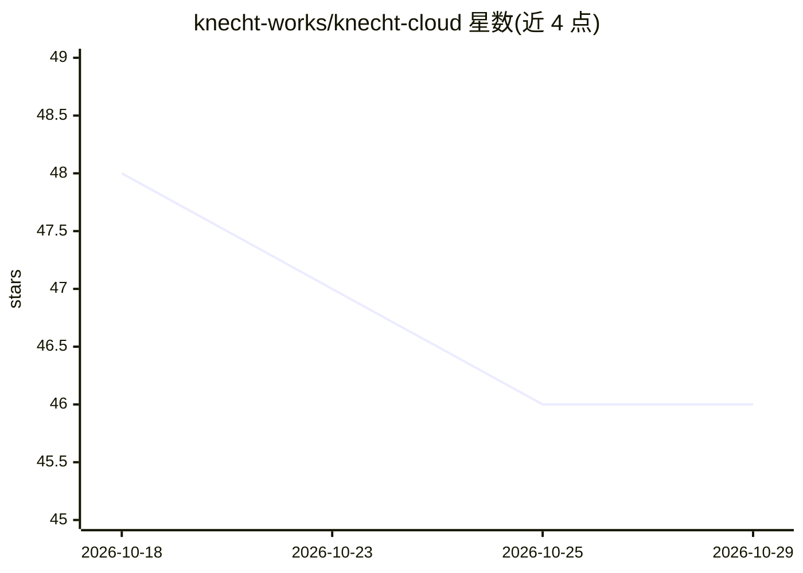

# knecht-works/knecht-cloud

⭐ 46 · TypeScript · NOASSERTION · 推送 2026-10-28 · [GitHub](https://github.com/knecht-works/knecht-cloud) · [官网](https://knecht.works) · 组织维护

**自托管平台：让 AI agent 在隔离沙箱中复现并修复 DDEV 项目 bug**

面向 DDEV 项目的自托管自动化平台：报告 bug 后，系统在隔离容器中启动项目沙箱，派 AI agent 进入其中复现故障、修改代码修复并自行验证，结果以 pull request 与预览环境返回。每次运行独立容器、网络与数据库；通过 GitHub App 集成交付，配 Nuxt UI 仪表盘与可配置 workflow。自托管于专属 Linux 主机（Ubuntu 24.04，至少 4GB RAM/40GB 磁盘），一键脚本安装，macOS 需经 Lima VM 运行；许可为 Functional Source License 1.1（ALv2 变体）。

## 筛选速览

| 维度 | 判定 | 备注 |
|---|---|---|
| AI 角色 | `ai-native` | 本体是模型或模型工具 |
| 许可风险 | `none` | NOASSERTION |
| 部署形态 | `self-host` | docker 或自建部署 |
| 模型依赖 | — | README 未给出锁定关系 |
| 硬件要求 | — | 无带数字的原话,不猜 |
| 安装摩擦 | `low` | 无编译、无系统依赖或容器化 |
| 成熟度 | — | 结构信号不足 |

## 能力要点

- AI agent 在隔离 ddev 沙箱中复现、修复并自验证 bug
- 每次运行独立容器、网络与数据库
- GitHub App 集成，修复以 pull request 加预览环境交付
- Nuxt UI 仪表盘统一管理项目、运行与 workflow

## 适用场景

- 报告 bug 后让 AI agent 自动复现并提交修复 PR
- 在隔离环境中验证修复而不影响本地环境
- 通过预览 URL 检查每次修复运行的结果

## 场景标签

`编码 Agent` `工作流自动化` · 领域:效率与自动化

## 证据(README 行号)

> L10: Knecht boots your DDEV projects in an isolated sandbox and sends an AI agent
> L24: 2. **Reproduce** - the AI agent steps into the sandbox and recreates the failure.
> L32: - **AI agent** - reproduces, fixes, and validates bugs on its own.

## 星数曲线

2026-10-18 48 → 2026-10-29 46（-2）

---
*卡片 v1 · prompt 1.4 · 生成 2026-10-25 · 置信度 mid · 依据 README sha `23f71bd95193` · [字段定义](../../DATASET.md)*
