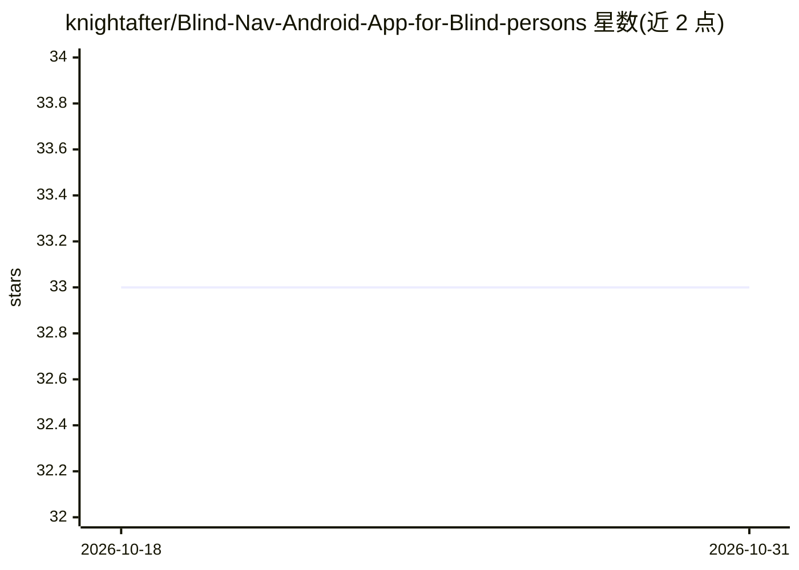

# knightafter/Blind-Nav-Android-App-for-Blind-persons

⭐ 33 · Kotlin · MIT · 推送 2026-08-29 · [GitHub](https://github.com/knightafter/Blind-Nav-Android-App-for-Blind-persons) · [官网](https://www.blindnav.live/) · 个人维护

**辅助视障人士导航的 Android 应用，基于手机摄像头与 AI**

面向视障用户的 Android 应用（Kotlin、Jetpack-Compose），提供三种模式：Navigation Mode 通过手机摄像头辅助环境导航；Assistant Mode 双击激活后可提问环境相关问题（如物体颜色、天气）及常识问题；Reading Mode 读取标识牌或书籍上的文字。主要功能依赖 Gemini AI API key，需自行克隆仓库、在 Android Studio 中将 key 填入 GeminiAI.kt 等三个文件。提供 YouTube 演示视频，MIT 许可。

## 筛选速览

| 维度 | 判定 | 备注 |
|---|---|---|
| AI 角色 | `ai-native` | 本体是模型或模型工具 |
| 许可风险 | `permissive` | MIT |
| 部署形态 | `None` |  |
| 模型依赖 | — | README 未给出锁定关系 |
| 硬件要求 | — | 无带数字的原话,不猜 |
| 安装摩擦 | `low` | 无编译、无系统依赖或容器化 |
| 成熟度 | — | 结构信号不足 |

## 能力要点

- 三种模式：导航、助手问答、文字读取
- 依赖手机摄像头与 Gemini API key 运行
- 助手模式支持环境提问（颜色/天气）与常识提问

## 适用场景

- 视障用户借助手机摄像头获取导航提示
- 通过语音/问答了解周围环境的物体颜色与天气
- 读取标识牌和书籍上的文字

## 场景标签

`OCR` `多模态` · 领域:感知与多模态

## 证据(README 行号)

> L17: 1️⃣ **Navigation Mode**: when the app is opened and the new session has been created then first Navigation Mode wil
> L21: 2️⃣ **Assistant Mode**: By double tap in the Navigation Mode then the Assistant Mode will be activated and the purp
> L26: 3️⃣ **Reading Mode** : Reading mode is a mode which will help the user in reading sign-boards or books etc. It's ba

## 星数曲线

2026-10-18 33 → 2026-10-31 33（+0）

---
*卡片 v1 · prompt 1.4 · 生成 2026-10-25 · 置信度 high · 依据 README sha `5c4dbdedad5b` · [字段定义](../../DATASET.md)*
