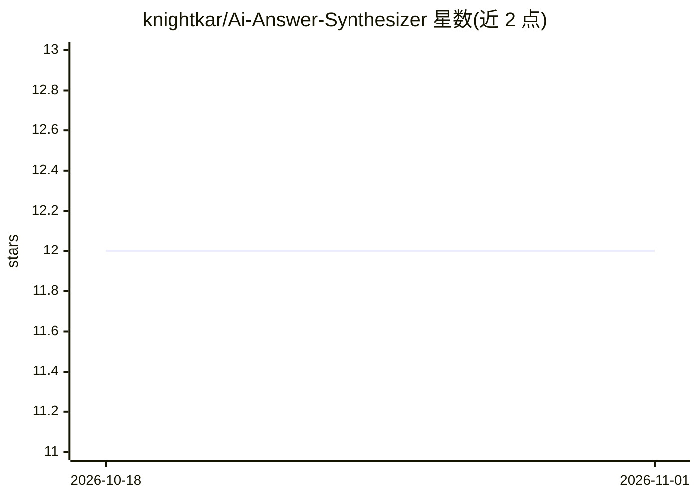

# knightkar/Ai-Answer-Synthesizer

⭐ 12 · MIT · 推送 2026-04-04 · [GitHub](https://github.com/knightkar/Ai-Answer-Synthesizer) · [官网](https://github.com/knightkar/Ai-Answer-Synthesizer#installation) · 个人维护

**给普通用户的 Claude 技能：将多个 AI 回答裁决为单一建议**

一个以 SKILL.md 形式发布的 Claude Skill：用户把对同一问题从 ChatGPT、Gemini、Copilot、Perplexity 等多个 AI 得到的回答粘贴进 Claude，该技能按 6 步分析方法抽取声明、计算一致度置信分、检测真实分歧与幻觉级联，输出单一建议、行动路径与可忽略清单。提供 Quick/Deep 两种模式，并通过 claude.ai Skills 设置页粘贴或 git clone 到 Claude Code 安装。MIT 许可，项目自述处于活跃维护状态。

## 筛选速览

| 维度 | 判定 | 备注 |
|---|---|---|
| AI 角色 | `ai-native` | 本体是模型或模型工具 |
| 许可风险 | `permissive` | MIT |
| 部署形态 | `None` |  |
| 模型依赖 | locked-api |  |
| 硬件要求 | — | 无带数字的原话,不猜 |
| 安装摩擦 | `low` | 无编译、无系统依赖或容器化 |
| 成熟度 | — | 结构信号不足 |

## 能力要点

- 6 步分析方法：抽取声明→置信评分→分歧检测→建议输出
- 含反共识偏见、幻觉级联检测、孤立声明标记等防护机制
- Quick 模式输出 2-4 句回答，Deep 模式输出完整结构化分析

## 适用场景

- 问了多个 AI 得到互相矛盾的答案，想要一个明确建议
- 作为新手被多个 AI 回答淹没，希望简化为可执行下一步
- 对比 ChatGPT、Claude、Gemini 的回答时判断哪些分歧是真实的

## 场景标签

`提示工程` · 领域:Agent 开发

## 证据(README 行号)

> L7:  Claude Skill
> L24: The AI Answer Synthesizer solves this. Paste multiple AI responses into Claude and get back:
> L60: 3. Copy the contents of `skills/ai-answer-synthesizer/SKILL.md`

## 星数曲线

2026-10-18 12 → 2026-11-01 12（+0）

---
*卡片 v1 · prompt 1.4 · 生成 2026-11-01 · 置信度 high · 依据 README sha `180a8ed7e030` · [字段定义](../../DATASET.md)*
