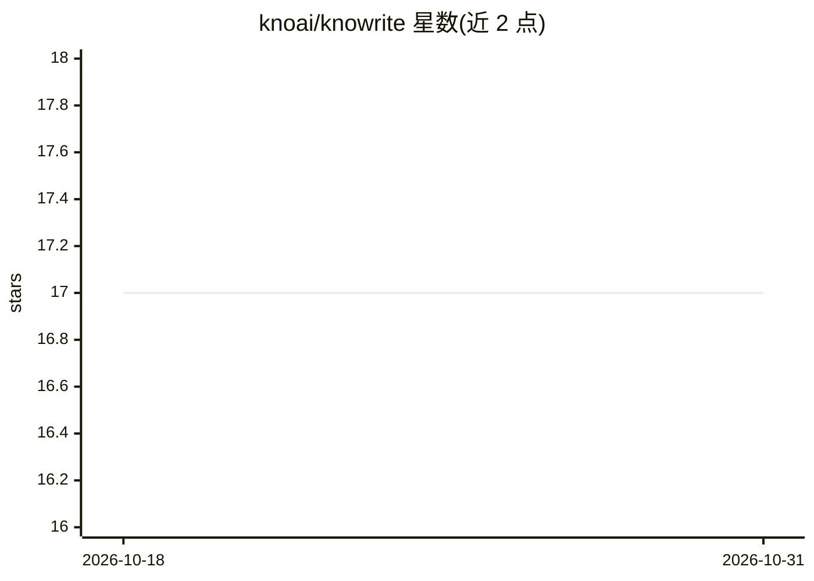

# knoai/knowrite

⭐ 17 · TypeScript · AGPL-3.0 · 推送 2026-05-09 · [GitHub](https://github.com/knoai/knowrite) · 组织维护 · 中文 README

**多 Agent 自动化小说创作后端：草稿、审校、润色、评估全自动**

基于 Node.js/Express 的小说创作后端服务：每章由 Writer、Editor、Humanizer、Proofreader、Reader、Summarizer、Fitness 七个 Agent 接力完成，含编辑双通道审校、五维质量评分、大纲偏离检测与自动改写循环。内置零外部向量库依赖的 RAG 记忆（SQLite 存储嵌入、纯 JS 余弦相似度）、角色情节记忆、声纹词典、三层记忆体系、书籍解构、技能自动抽取与 Prompt 自动进化。所有模型调用走 OpenAI 兼容协议，用户自配 Provider/API Key，无内置默认模型，单节点运行；配套 React 前端 knowrite-ui，另提供 MCP Server 供 Cursor/Claude Code 连接。

## 筛选速览

| 维度 | 判定 | 备注 |
|---|---|---|
| AI 角色 | `ai-native` | 本体是模型或模型工具 |
| 许可风险 | `viral` | AGPL-3.0 |
| 部署形态 | `self-host` | docker 或自建部署 |
| 模型依赖 | local-ok | 支持本地模型 |
| 硬件要求 | — | 无带数字的原话,不猜 |
| 安装摩擦 | `low` | 无编译、无系统依赖或容器化 |
| 成熟度 | — | 结构信号不足 |

## 能力要点

- 7-Agent 接力流水线：草稿→结构化审校→去 AI 化→润色→读者反馈→评分，零人工干预
- 零外部向量库的 RAG 记忆与三层记忆体系（工作/情节/语义记忆）
- 五维 Fitness 量化评分与基于低分样本的 Prompt 自动进化
- 内置 MCP Server（JSON-RPC 2.0 + SSE），支持 Cursor / Claude Code 等客户端直连

## 适用场景

- 让 AI Agent 流水线自动完成小说从大纲到成稿的全流程创作
- 解构已有小说文本，生成可复用的创作模板与作者风格指纹
- 通过对话式 Agent 对已生成章节做续写、修改与设定查询
- 在工业化审校与自由创作两种模式间切换生产网文内容

## 场景标签

`多智能体` `AI 写作` · 领域:Agent 开发

## 证据(README 行号)

> L21: AI Agents autonomously write novels — draft, review, revise, and evaluate, fully automated. A multi-agent collabora
> L23: **Knowrite is a Node.js / Express backend service** providing a complete automated novel creation API from outline 

## 星数曲线

2026-10-18 17 → 2026-10-31 17（+0）

---
*卡片 v1 · prompt 1.4 · 生成 2026-10-29 · 置信度 mid · 依据 README sha `13ee0b04a3e6` · [字段定义](../../DATASET.md)*
