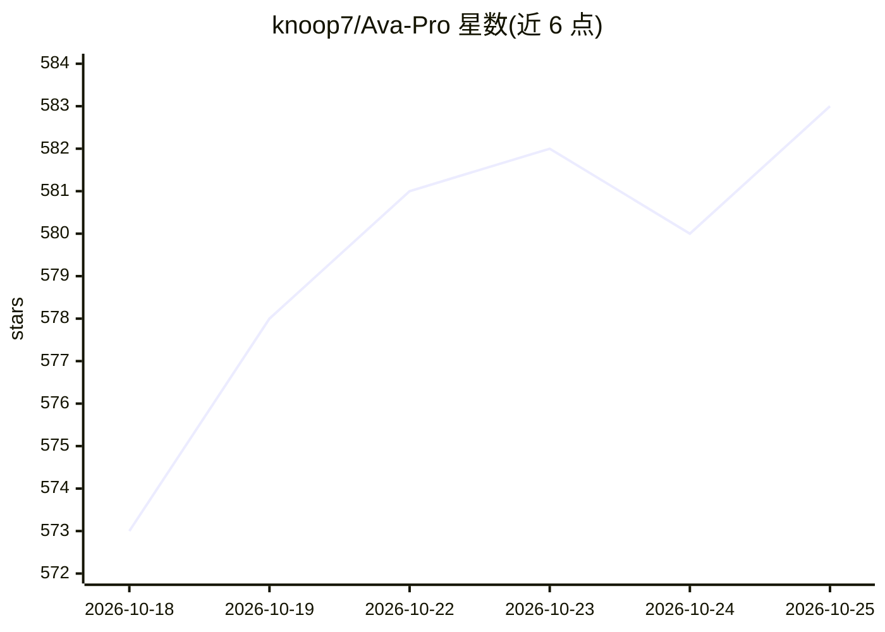

# knoop7/Ava-Pro

⭐ 583 · Kotlin · NOASSERTION · 推送 2026-10-12 · [GitHub](https://github.com/knoop7/Ava-Pro) · 个人维护

**把 Android 5+ 设备变成 Home Assistant 语音中控的伴侣应用**

面向 Home Assistant 用户的 Android 原生应用（核心引擎为 C++），单次安装即可让旧平板或手机充当 ESPHome 蓝牙代理、语音卫星、对讲、摄像头与环境传感器。语音部分在设备本地运行：自定义唤醒词、声纹识别、环境声检测；各模块可按需禁用。通过标准 ESPHome API 接入，无需 MQTT/HACS/自定义集成。另有运行时加载的 Mods（DLNA、AirPlay、离线 STT、Edge TTS 等）。安装方式为下载 APK，许可证为 CC BY-NC-ND 4.0（禁止商用与修改分发）。

## 筛选速览

| 维度 | 判定 | 备注 |
|---|---|---|
| AI 角色 | `ai-enhanced` | 去掉 AI 部分产品仍成立 |
| 许可风险 | `none` | NOASSERTION |
| 部署形态 | `None` |  |
| 模型依赖 | — | README 未给出锁定关系 |
| 硬件要求 | — | 无带数字的原话,不猜 |
| 安装摩擦 | `low` | 无编译、无系统依赖或容器化 |
| 成熟度 | — | 结构信号不足 |

## 能力要点

- 本地 C++ 语音管线：自定义唤醒词、声纹识别、环境声检测，全部端侧处理
- 经标准 ESPHome API 接入 Home Assistant，替代 ESP32 蓝牙代理与语音卫星硬件
- 模块完全解耦，可按设备能力只保留语音等单一功能
- Mods 运行时加载：DLNA/AirPlay、离线 STT、Edge TTS、Zigbee 网关等按需安装

## 适用场景

- 把闲置旧平板改造成全屋语音中控与蓝牙代理
- 为每个房间添置对讲、音乐同步与语音卫星节点
- 用一台设备集中管理（Fleet）家中所有 Ava 终端

## 场景标签

`语音 Agent` · 领域:对话与助手

## 证据(README 行号)

> L11: native Android platform built specifically for Home Assistant. A single, lightweight installation on existing devic
> L23: * **All functions can be disabled:** Device's Bluetooth chip too weak? Simply disable the Bluetooth proxy. Don't ne

## 星数曲线

2026-10-18 573 → 2026-10-25 583（+10）

---
*卡片 v1 · prompt 1.4 · 生成 2026-10-21 · 置信度 mid · 依据 README sha `c9560bc80a9d` · [字段定义](../../DATASET.md)*
