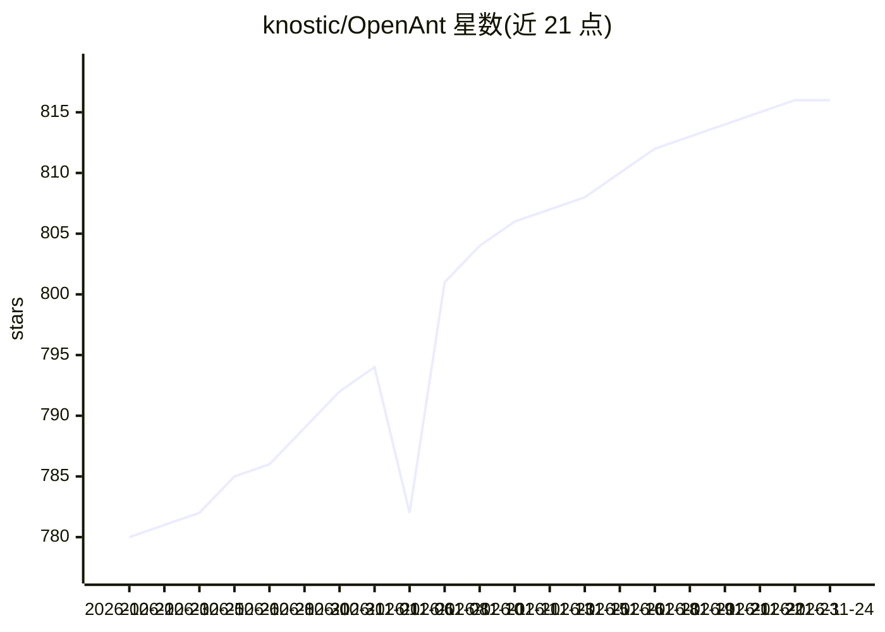

# knostic/OpenAnt

⭐ 816 · Python · Apache-2.0 · 推送 2026-11-23 · [GitHub](https://github.com/knostic/OpenAnt) · [官网](https://www.knostic.ai/openant) · 组织维护

**面向防御者的 LLM 驱动漏洞发现与修复 CLI 工具**

Knostic 以 Apache 2 许可发布的 LLM 漏洞发现工具（自称 harness）：流水线分阶段执行——检测、攻击验证、可达性审查、测试与报告生成，仅有存活验证的发现被输出。Go CLI 调度 Python 3.11+ 解析与分析代码，支持对 git diff/PR/staged 变更的增量扫描，CI 中以退出码 1 表示发现漏洞，并提供本地 Web UI 与补丁生成（Auto Patcher）。面向开源维护者与安全防御者，支持提交仓库免费扫描。

## 筛选速览

| 维度 | 判定 | 备注 |
|---|---|---|
| AI 角色 | `ai-native` | 本体是模型或模型工具 |
| 许可风险 | `permissive` | Apache-2.0 |
| 部署形态 | `desktop` | 安装包/桌面程序 |
| 模型依赖 | local-ok | 支持本地模型 |
| 硬件要求 | — | 无带数字的原话,不猜 |
| 安装摩擦 | `low` | 无编译、无系统依赖或容器化 |
| 成熟度 | `idea` | |

## 能力要点

- 两阶段验证流水线：Stage 1 检测、Stage 2 攻击，输出经验证的漏洞
- 按流水线阶段配置 (provider, model) 的 LLM 适配层，含 6 个内置适配器
- 基于 git diff/PR/staged/增量扫描以控制成本
- 本地 Web UI（仅绑定 loopback）与退出码契约供 CI 集成

## 适用场景

- 开源维护者主动扫描自己的仓库发现可验证的安全缺陷
- CI 流水线中对 PR/staged 变更做增量漏洞门禁
- 本地通过浏览器提交仓库并查看 HTML 报告与披露

## 场景标签

`网络安全` `代码审查` · 领域:编码与开发

## 证据(README 行号)

> L5: OpenAnt from Knostic is the first open source LLM-based vulnerability discovery and remediation product (now called 
> L73: OpenAnt routes each pipeline phase through a configurable (provider, model) pair. The fastest path is the interacti
> L132: OpenAnt's parsing, enhancement, analysis, and reporting code is Python 3.11+. The Go CLI picks an interpreter in t

## 星数曲线

2026-10-22 780 → 2026-11-24 816（+36）

---
*卡片 v1 · prompt 1.4 · 生成 2026-11-24 · 置信度 high · 依据 README sha `aedbe8f85db3` · [字段定义](../../DATASET.md)*
