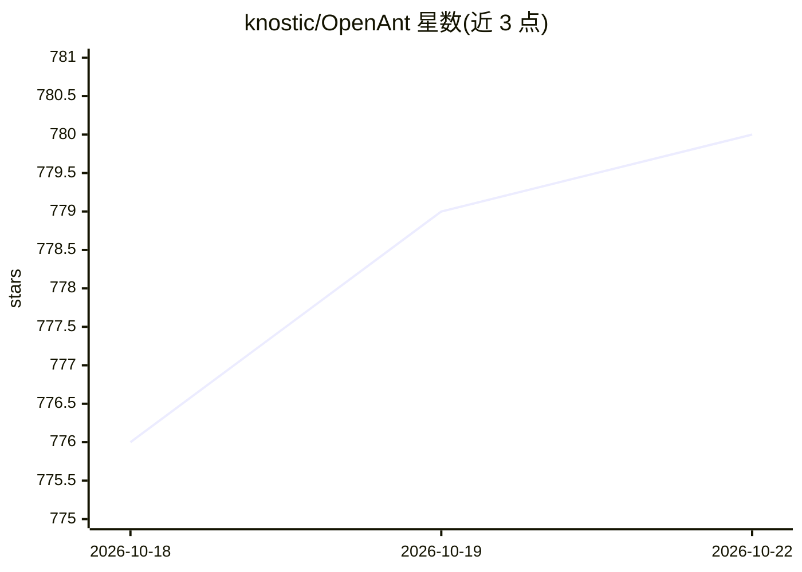

# knostic/OpenAnt

⭐ 781 · Python · Apache-2.0 · 推送 2026-10-22 · [GitHub](https://github.com/knostic/OpenAnt) · [官网](https://www.knostic.ai/openant) · 组织维护

**面向防御者的 LLM 漏洞发现与修复工具（Go CLI）**

由 Knostic 开源的 LLM 驱动漏洞发现与修复工具：两阶段流水线（Stage 1 检测、Stage 2 攻击验证以过滤误报），解析、增强、分析、验证到报告共七个阶段，每阶段可配置不同 provider/model。支持 Go、Python 稳定，另 7 种语言为 beta。提供 Go 编译的 CLI 与本地 Web UI（仅回环绑定），支持 diff 增量扫描、PR/预提交场景、自动补丁生成与 Trust Report，并提供开源项目免费扫描入口。分析过程会将源码发送至所配置的 LLM 提供商。

## 筛选速览

| 维度 | 判定 | 备注 |
|---|---|---|
| AI 角色 | `ai-native` | 本体是模型或模型工具 |
| 许可风险 | `permissive` | Apache-2.0 |
| 部署形态 | `desktop` | 安装包/桌面程序 |
| 模型依赖 | local-ok | 支持本地模型 |
| 硬件要求 | — | 无带数字的原话,不猜 |
| 安装摩擦 | `low` | 无编译、无系统依赖或容器化 |
| 成熟度 | `idea` | |

## 能力要点

- 两阶段流水线：检测+攻击验证，以存活结果确认为真实漏洞
- 每阶段可独立配置 (provider, model)，内置 Anthropic/OpenAI/Google/Bedrock/OpenRouter/Ollama 适配器
- diff/PR/staged 增量扫描，适合 CI 与预提交钩子
- openant serve 本地 Web UI，实时日志流与 HTML 报告

## 适用场景

- 开源维护者扫描仓库查找已验证的安全漏洞
- 在 CI 中按退出码契约（1=发现漏洞）门禁扫描结果
- 对 PR 或暂存区改动做增量安全扫描
- 为漏洞发现生成候选补丁与独立 Trust Report

## 场景标签

`网络安全` `代码审查` · 领域:编码与开发

## 证据(README 行号)

> L5: OpenAnt from Knostic is the first open source LLM-based vulnerability discovery and remediation product (now called 
> L91: |`anthropic`|console.anthropic.com|Reference adapter. NOT included in Claude Pro / Max subscriptions — separate bil
> L98: All of them support tool calling, so any of them can drive the `enhance` and `verify` phases that use the agentic t

## 星数曲线

2026-10-18 776 → 2026-10-22 780（+4）

---
*卡片 v1 · prompt 1.4 · 生成 2026-10-21 · 置信度 high · 依据 README sha `8a96286668ae` · [字段定义](../../DATASET.md)*
