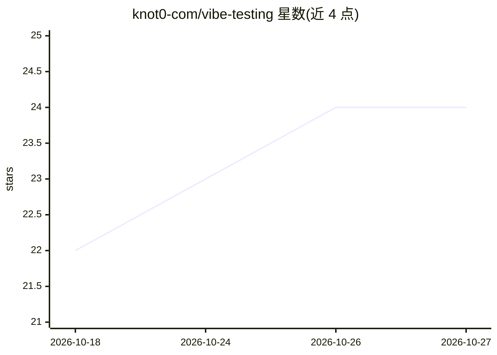

# knot0-com/vibe-testing

⭐ 24 · MIT · 推送 2026-03-22 · [GitHub](https://github.com/knot0-com/vibe-testing) · 组织维护

**用 LLM 推理对规格文档做场景压力测试的 agent 技能**

面向编码 agent 的技能包（Agent Skills 标准）：LLM 读取规格文档，按用户给定的具体场景（具名角色、目标、逐步交互）逐步推演，标记规格中的缺口、冲突与歧义，输出带严重度分级（BLOCKING/DEGRADED/COSMETIC）的结构化缺口报告。无需代码与测试框架，仅依赖推理。支持 Claude Code、OpenAI Codex、Gemini CLI、Cursor、GitHub Copilot 等 14+ 编码 agent，通过 git clone 到各 agent 的 skills 目录安装，附提示词模板与电商结账流程示例。

## 筛选速览

| 维度 | 判定 | 备注 |
|---|---|---|
| AI 角色 | `ai-ecosystem` | LLM/agent 周边工具 |
| 许可风险 | `permissive` | MIT |
| 部署形态 | `None` |  |
| 模型依赖 | — | README 未给出锁定关系 |
| 硬件要求 | — | 无带数字的原话,不猜 |
| 安装摩擦 | `low` | 无编译、无系统依赖或容器化 |
| 成熟度 | — | 结构信号不足 |

## 能力要点

- LLM 逐场景推演规格文档，输出结构化缺口报告
- 三级严重度分级：BLOCKING/DEGRADED/COSMETIC
- 兼容 Agent Skills 开放标准，支持 Claude Code/Codex/Gemini CLI 等 14+ agent
- 附模拟器提示词模板与完整电商结账示例

## 适用场景

- 写代码前发现规格中的设计缺口与冲突
- 团队共享技能统一规格评审流程
- 让编码 agent 在实现前验证规格可执行性

## 场景标签

 · 领域:软件开发/规格验证

## 证据(README 行号)

> L5: Vibe testing is a technique for validating specification documents by simulating real-world scenarios against them. 
> L26: Works with Claude Code, OpenAI Codex, Gemini CLI, Cursor, GitHub Copilot, OpenCode, and any tool supporting the Age

## 星数曲线

2026-10-18 22 → 2026-10-27 24（+2）

---
*卡片 v1 · prompt 1.4 · 生成 2026-10-27 · 置信度 high · 依据 README sha `d56f5b55f29c` · [字段定义](../../DATASET.md)*
