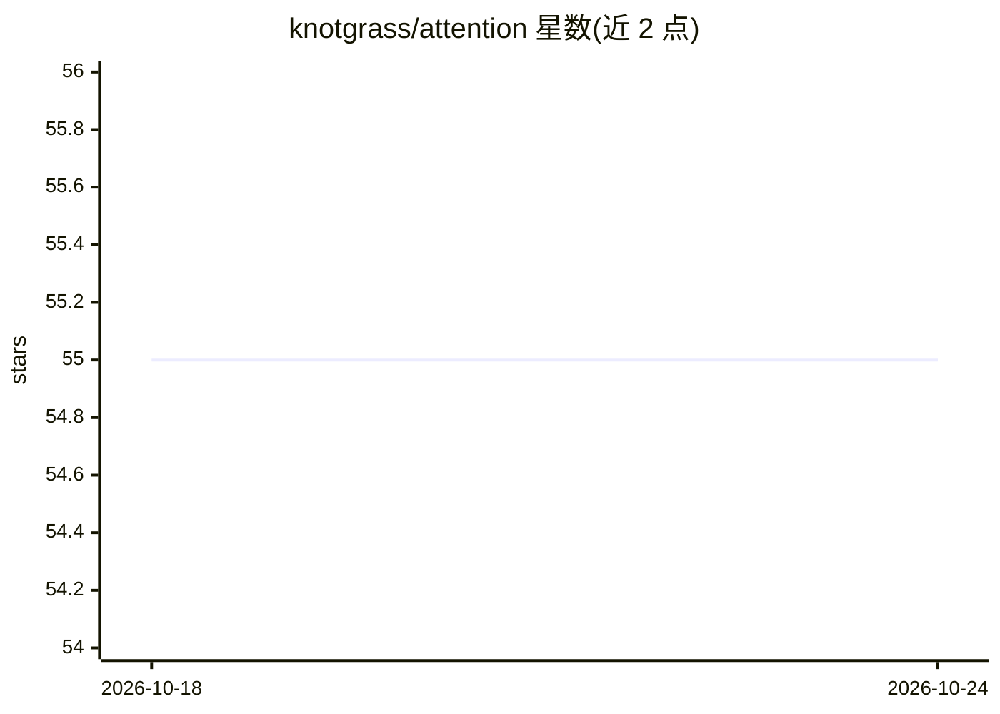

# knotgrass/attention

⭐ 55 · Python · 推送 2026-01-02 · [GitHub](https://github.com/knotgrass/attention) · 个人维护

**学习用 PyTorch 注意力模块集合：MHA/MQA/GQA/Linformer**

以理解注意力机制为目的，用 PyTorch 实现多种注意力模块：基础 Attention、Multi-head Attention、Multi-Query Attention、Grouped-Query Attention 以及将自注意力复杂度从 O(n²) 降为 O(n) 的 Linformer。作者声明这是未优化的简化实现，并在 README 中列出 flash attention、PyTorch 内置 scaled_dot_product_attention、Hugging Face、xformers 作为性能更好的替代方向，附四篇相关论文。README 未给出安装或使用命令。

## 筛选速览

| 维度 | 判定 | 备注 |
|---|---|---|
| AI 角色 | `ai-native` | 本体是模型或模型工具 |
| 许可风险 | `none` | — |
| 部署形态 | `None` |  |
| 模型依赖 | — | README 未给出锁定关系 |
| 硬件要求 | — | 无带数字的原话,不猜 |
| 安装摩擦 | `low` | 无编译、无系统依赖或容器化 |
| 成熟度 | — | 结构信号不足 |

## 能力要点

- 实现基础 Attention、Multi-head、Multi-Query、Grouped-Query 四种注意力模块
- 实现 Linformer，将自注意力复杂度降为 O(n)
- 自述为未优化的学习目的实现，并列出性能更好的替代库
- 附 Vaswani 2017、Shazeer 2019、Ainslie 2023、Wang 2020 四篇论文

## 适用场景

- 阅读源码理解 MHA/MQA/GQA 等注意力的实现原理
- 教学或自学 Transformer 注意力机制时的参考实现

## 场景标签

`教程课程` · 领域:学习与行业

## 证据(README 行号)

> L1: This repository implements several types of attention modules in PyTorch, including:
> L15: I implemented it in a simple way, with the purpose of understanding how attention works. It is an unoptimized versi

## 星数曲线

2026-10-18 55 → 2026-10-24 55（+0）

---
*卡片 v1 · prompt 1.4 · 生成 2026-10-24 · 置信度 high · 依据 README sha `001b263b4748` · [字段定义](../../DATASET.md)*
