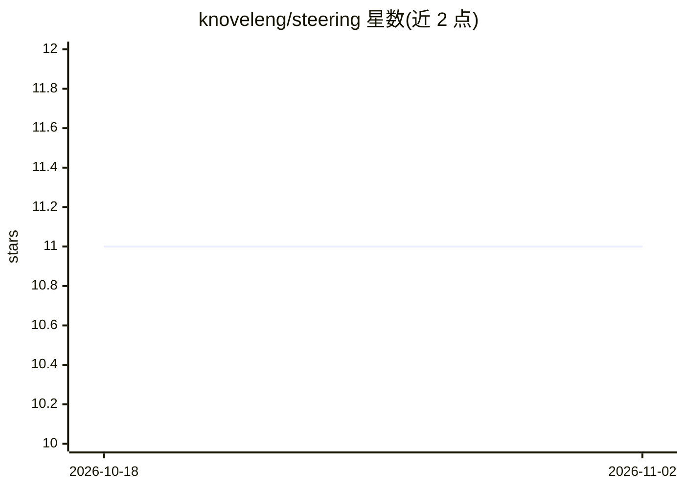

# knoveleng/steering

⭐ 11 · Jupyter Notebook · 推送 2026-09-13 · [GitHub](https://github.com/knoveleng/steering) · [官网](https://knoveleng.github.io/steering/) · 组织维护

**LLM 行为控制研究库：通过保范旋转实现激活层面的行为转向**

ACL 2026 论文 Selective Steering 的官方 Python 实现，面向研究者在激活空间对 LLM 做行为控制：提取特征方向、构造旋转平面、按判别式层级选择施加角度旋转，保持困惑度不变。支持 standard/selective/adaptive/addition/ablation 五种模式，支持 Transformers 与 vLLM 后端，覆盖 Gemma、LLaMA、Qwen 系列 8 个模型，并附困惑度、越狱评测与鲁棒性评测脚本及 Gradio 交互界面。需 CUDA GPU（建议 15GB 以上显存），Python 3.8+。

## 筛选速览

| 维度 | 判定 | 备注 |
|---|---|---|
| AI 角色 | `ai-ecosystem` | LLM/agent 周边工具 |
| 许可风险 | `permissive` | — |
| 部署形态 | `library` | 以包/库形式分发 |
| 模型依赖 | local-ok | 支持本地模型 |
| 硬件要求 | `gpu-8g` | |
| 安装摩擦 | `medium` | 含编译或系统依赖之一 |
| 成熟度 | — | 结构信号不足 |

## 能力要点

- 判别式层级选择与保范旋转的行为控制方法
- 支持 Transformers 与 vLLM 两种后端
- 内置困惑度、多评测器越狱检测与 5 个推理基准评测管线
- 提供 Gradio 交互式演示界面

## 适用场景

- 对 LLM 做安全对齐以减少有害输出
- 研究模型内部表征与可解释性
- 修改模型写作风格或响应模式并做评测

## 场景标签

 · 领域:AI 安全/对齐研究

## 证据(README 行号)

> L9: A Python library for precise behavioral control of Large Language Models through activation space manipulation. This
> L25: Selective Steering provides a principled approach to behavior modification in LLMs by:
> L88: from steering.pipeline import AngularSteeringPipeline

## 星数曲线

2026-10-18 11 → 2026-11-02 11（+0）

---
*卡片 v1 · prompt 1.4 · 生成 2026-11-02 · 置信度 mid · 依据 README sha `6924826db7a1` · [字段定义](../../DATASET.md)*
