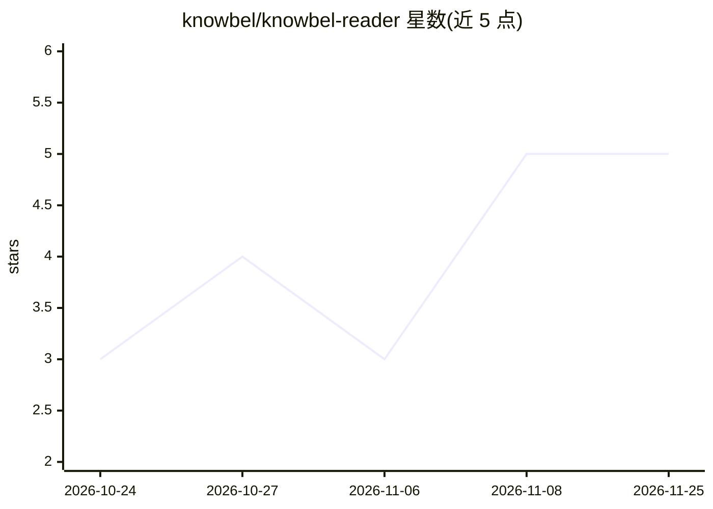

# knowbel/knowbel-reader

⭐ 5 · TypeScript · 推送 2026-11-14 · [GitHub](https://github.com/knowbel/knowbel-reader) · [官网](https://knowbel.github.io/) · 个人维护

**面向学生研读教材与论文的 PDF/EPUB 阅读器，AI 解答绑定原文出处**

以 PDF、EPUB 与 Markdown 为载体的学习型阅读器，覆盖高亮、批注、笔记、搜索、导出等阅读功能，并叠加 AI 学习层：Deep Dive 对选中段落结合上下文解释、Ask 针对全文/章节提问、Glossary 依据文档用法生成术语定义。回答流式输出并引用所依据的页码或章节，文档外声明会标记。需 Node.js 22.18+ 与至少一个模型服务商 API key 方可启用 AI 功能，桌面版还需 Rust 工具链与 Tauri 前置条件。目前仅在 macOS 上测试过。

## 筛选速览

| 维度 | 判定 | 备注 |
|---|---|---|
| AI 角色 | `ai-native` | 本体是模型或模型工具 |
| 许可风险 | `none` | — |
| 部署形态 | `library` | 以包/库形式分发 |
| 模型依赖 | locked-api |  |
| 硬件要求 | — | 无带数字的原话,不猜 |
| 安装摩擦 | `low` | 无编译、无系统依赖或容器化 |
| 成熟度 | — | 结构信号不足 |

## 能力要点

- Deep Dive/Ask/Glossary 三类 AI 学习工具，回答引用并跳转到原文位置
- 支持按功能角色（DIVE/ASK/GLOSSARY/QUICK）分别配置模型服务商
- 支持导入 PDF/EPUB/Markdown 及从 URL 保存网页/arXiv 论文
- 笔记可导出为 Markdown、HTML 或含源锚点的 .knowbel.zip

## 适用场景

- 研读教材和论文时对选中段落做深入讲解
- 就整篇文档或指定章节提问并获得带引文的回答
- 为文档中的术语建立基于原文用法的词汇表
- 将网页文章保存为可标注的 PDF 文档

## 场景标签

`文档问答` · 领域:知识与检索

## 证据(README 行号)

> L5: note-taking, and adds an AI study layer. You can select a passage and "deep
> L110: ### AI study tools
> L137: - An API key for at least one supported model provider (see

## 星数曲线

2026-10-24 3 → 2026-11-25 5（+2）

---
*卡片 v1 · prompt 1.4 · 生成 2026-11-21 · 置信度 high · 依据 README sha `d0a3896d7a8b` · [字段定义](../../DATASET.md)*
