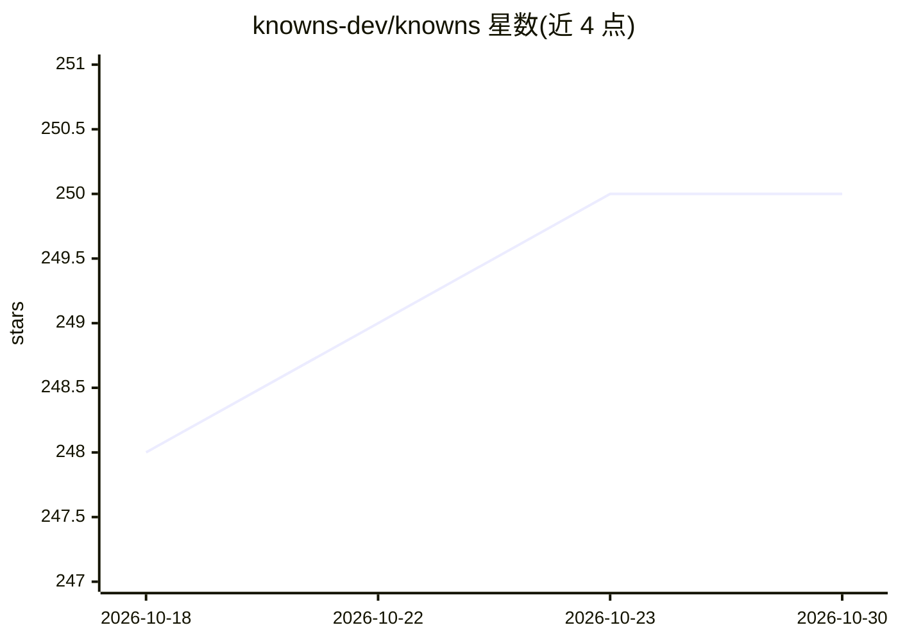

# knowns-dev/knowns

⭐ 250 · Go · MIT · 推送 2026-09-28 · [GitHub](https://github.com/knowns-dev/knowns) · [官网](http://knowns.sh) · 组织维护

**给 AI 编程助手提供持久化项目上下文层的自托管工具**

Knowns 是本地优先、可自托管的项目上下文层：把任务（含验收标准）、文档、规格、决策、三层记忆以结构化 markdown 存在仓库的 .knowns/ 目录，可提交 Git、无需云端。通过 CLI、MCP 服务器与同步的 agent skills 向 Claude Code、Codex、Cursor、Copilot 等 AI 编程助手提供访问；另含基于 ONNX 本地模型的离线语义搜索、LSP 代码智能、Handlebars 模板、git worktree 隔离的多阶段 agent 工作区与本地 Web UI。明确声明不替代 AI 助手，只提供共享上下文层。

## 筛选速览

| 维度 | 判定 | 备注 |
|---|---|---|
| AI 角色 | `ai-ecosystem` | LLM/agent 周边工具 |
| 许可风险 | `permissive` | MIT |
| 部署形态 | `library` | 以包/库形式分发 |
| 模型依赖 | — | README 未给出锁定关系 |
| 硬件要求 | — | 无带数字的原话,不猜 |
| 安装摩擦 | `low` | 无编译、无系统依赖或容器化 |
| 成熟度 | — | 结构信号不足 |

## 能力要点

- 任务/文档/规格/决策/三层记忆以结构化 markdown 存于 .knowns/，可提交 Git
- MCP 服务器 + CLI + agent skills 接入 Claude Code、Codex、Cursor 等助手
- 本地 ONNX 模型语义搜索，完全离线、无需 API key
- LSP 代码智能、knowns doctor 诊断、Web UI（看板/知识图谱）

## 适用场景

- 让 AI 编程助手跨会话记住项目架构与编码约定
- 团队共享同一套任务、规格与决策上下文，减少重复解释
- 开源维护者帮助人类或 AI 贡献者快速上手项目
- 通过 /kn-* 技能工作流引导 agent 完成研究-规划-实现-评审

## 场景标签

`Agent 记忆` `知识库管理` · 领域:Agent 开发

## 证据(README 行号)

> L65: Knowns is a **local-first, self-hostable project context layer** for AI-native development.
> L164: Full Model Context Protocol server. Claude Code, Codex, Cursor, OpenCode, and other MCP-compatible assistants get 
> L227: Knowns does not replace your AI assistant. It gives the assistants you already use one shared project context laye

## 星数曲线

2026-10-18 248 → 2026-10-30 250（+2）

---
*卡片 v1 · prompt 1.4 · 生成 2026-10-22 · 置信度 high · 依据 README sha `80284240a6d9` · [字段定义](../../DATASET.md)*
