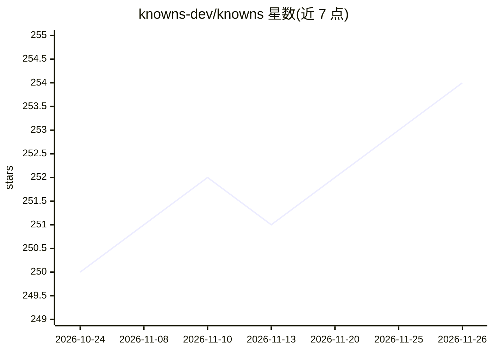

# knowns-dev/knowns

⭐ 254 · TypeScript · MIT · 推送 2026-11-25 · [GitHub](https://github.com/knowns-dev/knowns) · [官网](http://knowns.sh) · 组织维护 · 中文 README

**为 AI 编码代理提供项目任务/文档/决策上下文层**

Knowns 是一个本地优先、可自托管的项目上下文层，用仓库内 `.knowns/` 目录的纯 markdown 文件存储任务（含验收标准）、文档、规格、三层记忆与系统决策，通过 CLI 和 MCP 服务器暴露给 AI 编码助手；附带 LSP 代码智能、基于本地 Ollama+Qdrant 的离线语义搜索、Handlebars 模板生成、Web UI 与多阶段 agent 工作区。安装经 brew/npm。定位是配合既有 AI 助手而非替代它们。

## 筛选速览

| 维度 | 判定 | 备注 |
|---|---|---|
| AI 角色 | `ai-ecosystem` | LLM/agent 周边工具 |
| 许可风险 | `permissive` | MIT |
| 部署形态 | `library` | 以包/库形式分发 |
| 模型依赖 | local-ok | 支持本地模型 |
| 硬件要求 | — | 无带数字的原话,不猜 |
| 安装摩擦 | `low` | 无编译、无系统依赖或容器化 |
| 成熟度 | — | 结构信号不足 |

## 能力要点

- 通过 CLI 与 MCP 服务器向 AI 助手暴露任务、文档、记忆与验证
- 三层记忆（项目/会话/全局）与可验证生命周期的系统决策记录
- 基于本地 Ollama 嵌入与本地 Qdrant 的离线语义搜索，无需 API key
- LSP 代码智能与多阶段 agent 工作区（git worktree 隔离）

## 适用场景

- 让 Claude Code/Codex 等助手跨会话记住项目架构与决策
- 以带验收标准的任务驱动 AI 实现
- 在本地离线环境对项目知识做语义搜索
- 为团队统一共享 AI 编码的项目上下文

## 场景标签

`Agent 记忆` `语义搜索` · 领域:Agent 开发

## 证据(README 行号)

> L65: Knowns is a **local-first, self-hostable project context layer** for AI-native development.
> L67: It stores your project knowledge in structured, AI-readable files - and exposes them to AI assistants through CLI a
> L227: Knowns does not replace your AI assistant. It gives the assistants you already use one shared project context laye

## 星数曲线

2026-10-24 250 → 2026-11-26 254（+4）

---
*卡片 v1 · prompt 1.4 · 生成 2026-11-25 · 置信度 high · 依据 README sha `6540f7d15980` · [字段定义](../../DATASET.md)*
