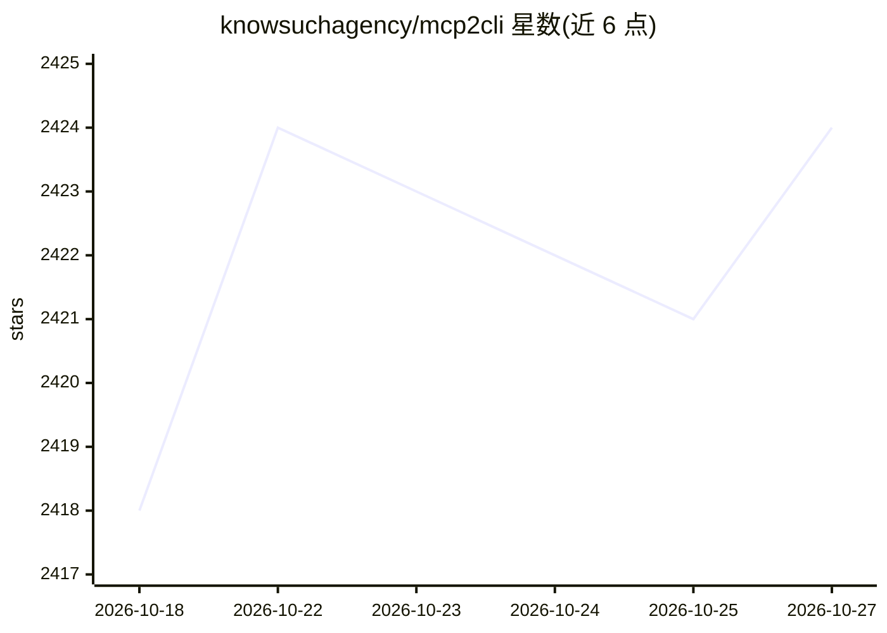

# knowsuchagency/mcp2cli

⭐ 2,424 · Python · MIT · 推送 2026-10-12 · [GitHub](https://github.com/knowsuchagency/mcp2cli) · [官网](https://pypi.org/project/mcp2cli/) · 个人维护

**把 MCP/OpenAPI/GraphQL 服务在运行时转为 CLI 的工具**

面向开发者与 AI agent 的命令行工具：在运行时连接 MCP 服务器（HTTP/SSE/stdio）、OpenAPI 规范与 GraphQL 端点，动态发现工具与操作并转为 CLI 子命令，无需代码生成。内置 OAuth 授权码+PKCE 流程与令牌缓存、env:/file: 密钥读取、bake 模式保存连接配置、基于本地调用频率的工具排序以降低 LLM token 消耗，并强制 --json 输出。附带可安装技能，教 Claude Code/Cursor/Codex 等 AI 编码 agent 使用本工具。通过 uvx 直接运行或 uv 全局安装。

## 筛选速览

| 维度 | 判定 | 备注 |
|---|---|---|
| AI 角色 | `ai-ecosystem` | LLM/agent 周边工具 |
| 许可风险 | `permissive` | MIT |
| 部署形态 | `library` | 以包/库形式分发 |
| 模型依赖 | — | README 未给出锁定关系 |
| 硬件要求 | — | 无带数字的原话,不猜 |
| 安装摩擦 | `low` | 无编译、无系统依赖或容器化 |
| 成熟度 | — | 结构信号不足 |

## 能力要点

- 运行时将 MCP/OpenAPI/GraphQL 动态转为 CLI 子命令，零代码生成
- OAuth 授权码+PKCE 流程，令牌持久化与自动刷新，支持无浏览器主机的手动回调
- bake 模式将连接与认证配置保存为命名配置，支持 include/exclude/methods 过滤
- 基于本地调用频率的工具排序与强制 JSON 输出，面向 LLM agent 降低 token 成本

## 适用场景

- 把 MCP 服务器或 OpenAPI/GraphQL API 当作本地命令行直接调用
- AI 编码 agent 通过本工具发现并调用 MCP/OpenAPI 工具
- 为 LLM agent 精简工具列表以减少每轮 token 消耗

## 场景标签

 · 领域:AI 工具链/CLI

## 证据(README 行号)

> L5:  Turn any MCP server, OpenAPI spec, or GraphQL endpoint into a CLI — at runtime, with zero codegen.
> L21: mcp2cli ships with an installable skill that teaches AI coding agents (Claude Code, Cursor, Codex) how to use it. O
> L163: mcp2cli tracks tool invocations locally and uses that data to rank `--list` output, reducing token costs for LLM a

## 星数曲线

2026-10-18 2,418 → 2026-10-27 2,424（+6）

---
*卡片 v1 · prompt 1.4 · 生成 2026-10-21 · 置信度 mid · 依据 README sha `24c431616173` · [字段定义](../../DATASET.md)*
