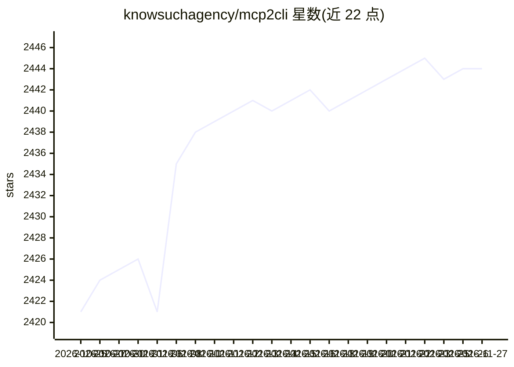

# knowsuchagency/mcp2cli

⭐ 2,444 · Python · MIT · 推送 2026-11-09 · [GitHub](https://github.com/knowsuchagency/mcp2cli) · [官网](https://pypi.org/project/mcp2cli/) · 个人维护

**把 MCP/OpenAPI/GraphQL 服务器在运行时转成 CLI 的工具**

一个 Python CLI 工具：运行时内省 MCP 服务器、OpenAPI 规范或 GraphQL 端点，动态生成子命令供人在终端或 LLM agent 调用，无需代码生成。机制包括压缩工具 schema 以减少 token 消耗、OAuth 认证（含无浏览器主机的手动回调流程）、命名会话守护进程复用 MCP 连接、本地使用频率排序、强制 JSON 输出与规范缓存。通过 uv 安装，另提供可供 AI 编码 agent 安装的技能包。

## 筛选速览

| 维度 | 判定 | 备注 |
|---|---|---|
| AI 角色 | `ai-ecosystem` | LLM/agent 周边工具 |
| 许可风险 | `permissive` | MIT |
| 部署形态 | `library` | 以包/库形式分发 |
| 模型依赖 | — | README 未给出锁定关系 |
| 硬件要求 | — | 无带数字的原话,不猜 |
| 安装摩擦 | `low` | 无编译、无系统依赖或容器化 |
| 成熟度 | — | 结构信号不足 |

## 能力要点

- 运行时将 MCP/OpenAPI/GraphQL 转为 CLI 子命令，零代码生成
- OAuth 开箱即用，支持 headless 主机的手动回调流程
- 命名会话守护进程复用 MCP 连接（Unix socket/回环 TCP + 令牌鉴权）
- 本地使用统计驱动的工具排序与强制 JSON 输出，面向 LLM agent

## 适用场景

- 在终端直接调用 MCP 服务器工具而不用写客户端代码
- 让 AI coding agent 以更低 token 成本发现并调用 API
- 为 OpenAPI/GraphQL 端点生成可复用的 baked 配置工具

## 场景标签

 · 领域:开发工具/API 接入

## 证据(README 行号)

> L5:  Turn any MCP server, OpenAPI spec, or GraphQL endpoint into a CLI — at runtime, with zero codegen.
> L21: mcp2cli ships with an installable skill that teaches AI coding agents (Claude Code, Cursor, Codex) how to use it. O
> L216: mcp2cli tracks tool invocations locally and uses that data to rank `--list` output, reducing token costs for LLM a

## 星数曲线

2026-10-25 2,421 → 2026-11-27 2,444（+23）

---
*卡片 v1 · prompt 1.4 · 生成 2026-11-23 · 置信度 mid · 依据 README sha `5bdfc7457992` · [字段定义](../../DATASET.md)*
