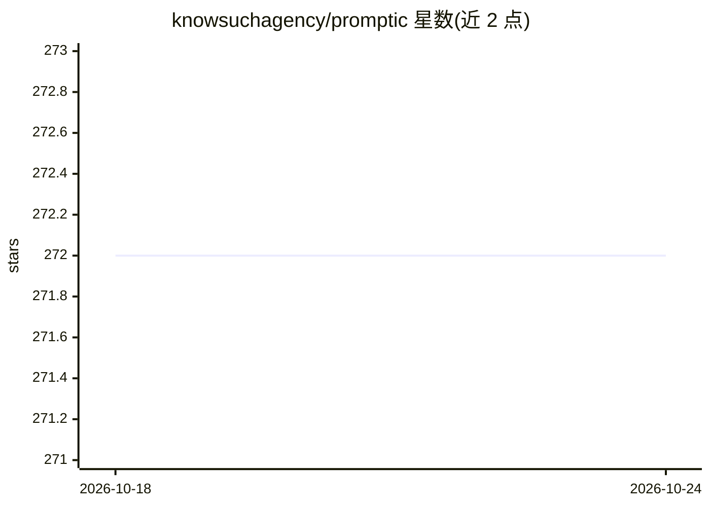

# knowsuchagency/promptic

⭐ 272 · Python · Apache-2.0 · 推送 2026-10-12 · [GitHub](https://github.com/knowsuchagency/promptic) · [官网](https://pypi.org/project/promptic/) · 个人维护

**Python LLM 应用开发装饰器库：函数即提示模板**

基于 LiteLLM 的 Python 库，用 @llm 装饰器把函数 docstring 与参数组合为提示词并返回模型响应，支持 Pydantic/JSON Schema 结构化输出、@llm.tool 函数调用构建 agent、流式响应、对话记忆（可扩展 State 类自定义持久化）与提示缓存（Anthropic 临时缓存块控制，最多 4 块）。认证经 api_key 参数、环境变量或 litellm 设置，覆盖 OpenAI/Anthropic/Google 模型；也可直接使用 OpenAI 客户端替代 litellm。限制：Gemini 模型工具调用不支持流式，图像+结构化输出存在模型特定问题。集成 Weave 追踪与 VCR.py 测试回放。

## 筛选速览

| 维度 | 判定 | 备注 |
|---|---|---|
| AI 角色 | `ai-ecosystem` | LLM/agent 周边工具 |
| 许可风险 | `permissive` | Apache-2.0 |
| 部署形态 | `library` | 以包/库形式分发 |
| 模型依赖 | — | README 未给出锁定关系 |
| 硬件要求 | — | 无带数字的原话,不猜 |
| 安装摩擦 | `low` | 无编译、无系统依赖或容器化 |
| 成熟度 | — | 结构信号不足 |

## 能力要点

- @llm 装饰器将函数 docstring 与参数生成提示词
- Pydantic 模型返回类型注解实现结构化输出并自动校验
- @llm.tool 注册工具函数构建 agent，支持 dry_run 模拟调用
- 内置对话记忆与可扩展 State 持久化，Anthropic 提示缓存控制

## 适用场景

- 用少量代码把普通 Python 函数变成 LLM 调用
- 构建带工具调用的 agent 与多轮对话应用
- 需要结构化（Pydantic 校验）输出的 LLM 功能集成
- 用 VCR 录制回放做低成本确定性测试

## 场景标签

`提示工程` `Agent 框架` · 领域:Agent 开发

## 证据(README 行号)

> L9: Promptic aims to be the "requests" of LLM development -- the most productive and pythonic way to build LLM applicati
> L31: Functions decorated with `@llm` use its docstring as a prompt template. When the function is called, promptic combi

## 星数曲线

2026-10-18 272 → 2026-10-24 272（+0）

---
*卡片 v1 · prompt 1.4 · 生成 2026-10-22 · 置信度 high · 依据 README sha `1fa21c92938a` · [字段定义](../../DATASET.md)*
