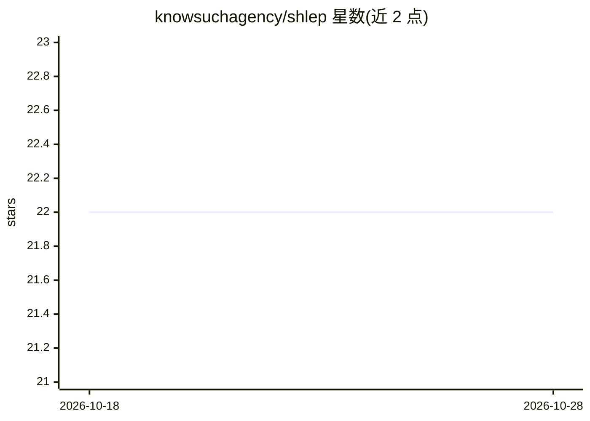

# knowsuchagency/shlep

⭐ 22 · Python · Apache-2.0 · 推送 2026-10-12 · [GitHub](https://github.com/knowsuchagency/shlep) · 个人维护

**把目录内容打包成单个文件以便传给 ChatGPT 的 CLI 工具**

Python 命令行工具，读取指定目录的文件内容并合并为单个输出（支持 JSON、CSV、纯文本格式），便于上传给 ChatGPT 或配合 code interpreter 插件使用。自动排除 .gitignore 匹配的文件，也支持自定义排除模式；输出可写入文件或打印到 stdout。既可作为 CLI 使用，也可在 Python 代码中编程调用。通过 pipx/PyPI 安装。

## 筛选速览

| 维度 | 判定 | 备注 |
|---|---|---|
| AI 角色 | `ai-ecosystem` | LLM/agent 周边工具 |
| 许可风险 | `permissive` | Apache-2.0 |
| 部署形态 | `library` | 以包/库形式分发 |
| 模型依赖 | — | README 未给出锁定关系 |
| 硬件要求 | — | 无带数字的原话,不猜 |
| 安装摩擦 | `low` | 无编译、无系统依赖或容器化 |
| 成熟度 | — | 结构信号不足 |

## 能力要点

- 支持 JSON/CSV/纯文本三种输出格式
- 自动遵循 .gitignore 并支持额外排除模式
- 可输出到文件或 stdout
- 支持 CLI 与 Python 编程两种使用方式

## 适用场景

- 把项目目录打包后上传给 ChatGPT 做代码分析
- 配合 ChatGPT code interpreter 插件处理整个目录
- 按排除规则筛选文件后生成单一可读文本

## 场景标签

 · 领域:开发者工具/LLM 输入准备

## 证据(README 行号)

> L5: `shlep` lets you package your directory's content in a format that can be easily passed to ChatGPT. This is especial
> L6: useful when using the code interpreter plugin!
> L30: `shlep` can be used as a command-line tool or programmatically in your Python code.

## 星数曲线

2026-10-18 22 → 2026-10-28 22（+0）

---
*卡片 v1 · prompt 1.4 · 生成 2026-10-27 · 置信度 high · 依据 README sha `2675243118f0` · [字段定义](../../DATASET.md)*
