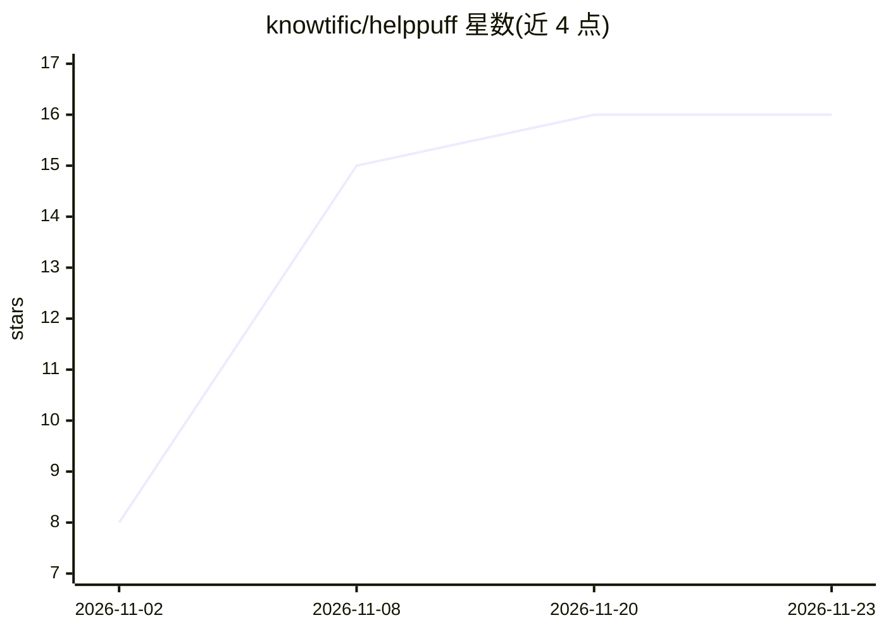

# knowtific/helppuff

⭐ 16 · TypeScript · MIT · 推送 2026-11-17 · [GitHub](https://github.com/knowtific/helppuff) · [官网](https://knowtific.github.io/helppuff/) · 组织维护

**部署在自有 Cloudflare 账号上的网站 AI 聊天助手与 CRM**

面向网站所有者的开源 AI 聊天助手：一条命令（npx 或交给 Claude Code/Codex 等编码代理粘贴提示词）完成部署，抓取网站内容构建知识库，用 Workers AI（GLM-4.7 Flash + BGE-M3 嵌入 + 重排）回答访客问题，并提供对话、线索捕获、内置 CRM、人工客服、预约、任务看板与 webhooks。默认整个栈运行在用户自己的 Cloudflare 账号（Workers 免费计划，约每日 300 次 AI 回答），数据存于 D1/KV/Vectorize；可切换 OpenAI/Gemini/Claude 等后端。

## 筛选速览

| 维度 | 判定 | 备注 |
|---|---|---|
| AI 角色 | `ai-native` | 本体是模型或模型工具 |
| 许可风险 | `permissive` | MIT |
| 部署形态 | `library` | 以包/库形式分发 |
| 模型依赖 | locked-api |  |
| 硬件要求 | — | 无带数字的原话,不猜 |
| 安装摩擦 | `low` | 无编译、无系统依赖或容器化 |
| 成熟度 | — | 结构信号不足 |

## 能力要点

- 默认全栈运行在用户自有 Cloudflare 账号，适配 Workers 免费计划
- 由编码代理（Claude Code/Codex/Cursor 等）通过 instructions.md 全自动部署与运维
- 知识库混合语义+关键词检索（GLM-4.7 Flash + BGE-M3 + BGE 重排）
- 内置 CRM、线索捕获、人工客服、预约、任务看板与签名 webhooks

## 适用场景

- 在网站上部署可学习自有内容并回答访客的 AI 客服
- 把聊天线索沉淀为 CRM 跟进与回调任务
- 不依赖聊天机器人托管服务商，自主持有客户数据

## 场景标签

`聊天机器人` `RAG` · 领域:对话与助手

## 证据(README 行号)

> L7: HelpPuff is an open-source AI chat assistant for websites, and an **AI-agent
> L9: everything up for you. It learns your content, answers visitors, captures
> L133: |**Workers AI**|Writes answers and summaries, reads business details, converts uploaded documents to Markdown, cre

## 星数曲线

2026-11-02 8 → 2026-11-23 16（+8）

---
*卡片 v1 · prompt 1.4 · 生成 2026-11-18 · 置信度 high · 依据 README sha `6ceb80121dfa` · [字段定义](../../DATASET.md)*
