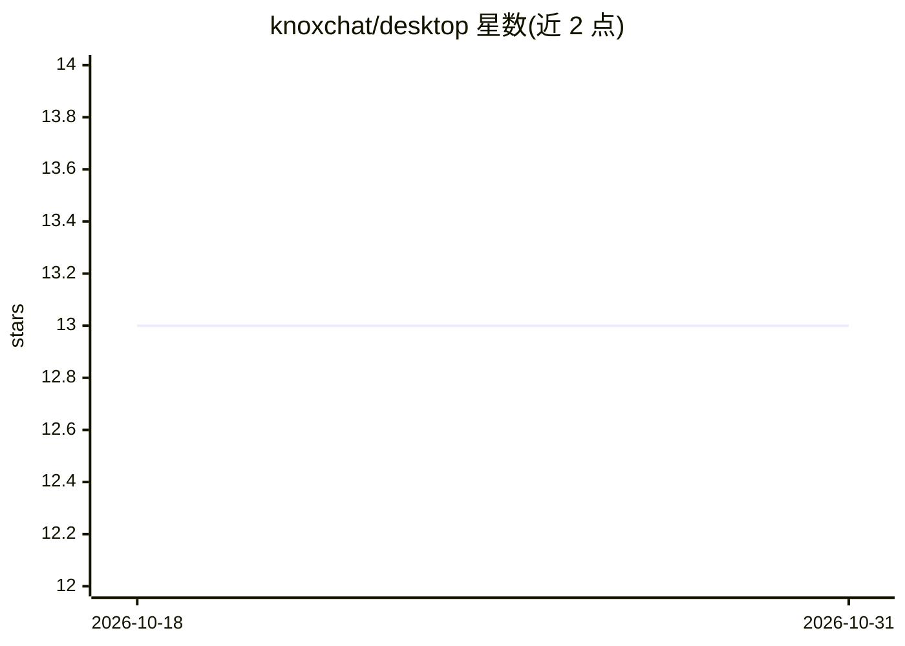

# knoxchat/desktop

⭐ 13 · AGPL-3.0 · 推送 2026-07-28 · [GitHub](https://github.com/knoxchat/desktop) · [官网](https://knox.chat) · 组织维护

**跨平台 AI 聊天桌面应用：聚合 100+ 模型与内置 VS Code 编辑器**

KnoxChat 平台的桌面客户端，通过统一界面访问 OpenAI、Anthropic、Google、DeepSeek 等 100+ 模型，包含 Knox-MS 记忆系统（工作/短期/长期/永久分层存储、向量检索、跨会话记忆与自动摘要）、智能供应商路由（自动故障转移、按延迟与成本选路）、内置 VS Code 风格代码编辑器与 AI 编码助手。macOS 提供 DMG（Apple Silicon），Windows/Linux 标注 Coming soon。按用量付费，需账号登录与充值，兼容 OpenAI API。

## 筛选速览

| 维度 | 判定 | 备注 |
|---|---|---|
| AI 角色 | `ai-native` | 本体是模型或模型工具 |
| 许可风险 | `viral` | AGPL-3.0 |
| 部署形态 | `desktop` | 安装包/桌面程序 |
| 模型依赖 | locked-api |  |
| 硬件要求 | — | 无带数字的原话,不猜 |
| 安装摩擦 | `low` | 无编译、无系统依赖或容器化 |
| 成熟度 | — | 结构信号不足 |

## 能力要点

- 统一界面访问 100+ AI 模型（OpenAI/Anthropic/Google/DeepSeek 等）
- Knox-MS 记忆系统：分层存储、向量检索、跨会话记忆与自动摘要
- 内置 VS Code 风格编辑器，AI 编码助手嵌入项目
- 供应商自动路由：故障转移、延迟与成本优化

## 适用场景

- 在一个应用里同时使用多家厂商的 AI 模型
- 在集成编辑器中边写代码边获得 AI 建议
- 长对话与多会话研究中保持上下文记忆
- 同一提示词跨模型即时对比效果

## 场景标签

`聊天机器人` `AI 助手` · 领域:对话与助手

## 证据(README 行号)

> L17: Access the world's leading AI models through a single unified interface:
> L59: - **KnoxChat Agent Coding — AI-powered coding assistant available in every project

## 星数曲线

2026-10-18 13 → 2026-10-31 13（+0）

---
*卡片 v1 · prompt 1.4 · 生成 2026-10-31 · 置信度 high · 依据 README sha `c754bb8733ce` · [字段定义](../../DATASET.md)*
