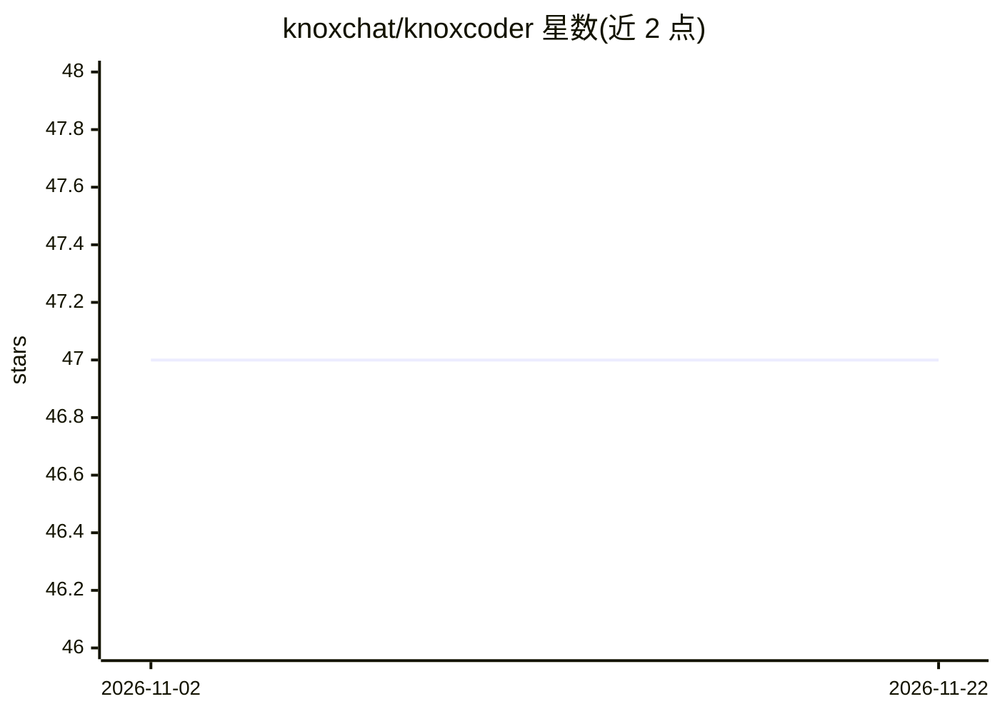

# knoxchat/knoxcoder

⭐ 47 · TypeScript · NOASSERTION · 推送 2026-11-13 · [GitHub](https://github.com/knoxchat/knoxcoder) · [官网](https://knoxstudio.ai) · 组织维护

**内置受治理编码代理的企业 VS Code 衍生编辑器**

基于 VS Code 开源代码构建的企业代码编辑器，保留工作台、语言、调试器、终端、Git 与扩展宿主。核心围绕两点重构：Knox 原生编码代理作为系统级组件（非市场安装），配备本地 Memory Brain 长期记忆（本地词法检索，无嵌入、无向量云）与不依赖 Git 的可回滚 Checkpoints（每次文件变更前自动捕获，可恢复文件及对应知识）。支持权限模式、工具策略、hooks、技能、自定义子代理与团队包做治理。不采用上游 Copilot/Chat/Agent Host 栈，不发送 Microsoft 遥测，GPL-3.0 许可。

## 筛选速览

| 维度 | 判定 | 备注 |
|---|---|---|
| AI 角色 | `ai-native` | 本体是模型或模型工具 |
| 许可风险 | `none` | NOASSERTION |
| 部署形态 | `None` |  |
| 模型依赖 | — | README 未给出锁定关系 |
| 硬件要求 | — | 无带数字的原话,不猜 |
| 安装摩擦 | `low` | 无编译、无系统依赖或容器化 |
| 成熟度 | — | 结构信号不足 |

## 能力要点

- Knox 原生编码代理：多文件规划/审查/执行，破坏性操作受策略门控
- Memory Brain 设备端长期记忆，本地词法检索，无嵌入无向量库
- git-independent Checkpoints：按轮次恢复、cherry-pick、blame 到引入轮次、导出补丁
- 权限模式/工具策略/hooks/技能/子代理/团队包构成治理体系

## 适用场景

- 企业团队在熟悉的 VS Code 环境中运行受策略治理的编码代理
- 需要代理修改可回滚且记忆留在本地的场景
- 组织需对代理行为、记忆与网络流量做合规管控

## 场景标签

`编码 Agent` `Agent 记忆` · 领域:Agent 开发

## 证据(README 行号)

> L3: KnoxCoder is an enterprise code editor built on Visual Studio Code open source. It keeps the workbench, languages, d
> L27: - **Agent.** Plans, reviews, and executes multi-file work under Edits or Auto permission, with Plan mode for design

## 星数曲线

2026-11-02 47 → 2026-11-22 47（+0）

---
*卡片 v1 · prompt 1.4 · 生成 2026-11-18 · 置信度 high · 依据 README sha `cc02721dd9ac` · [字段定义](../../DATASET.md)*
