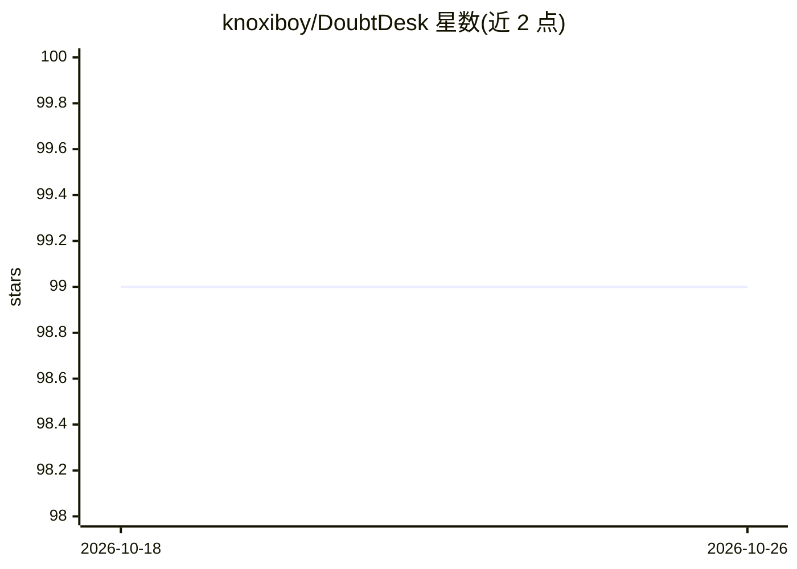

# knoxiboy/DoubtDesk

⭐ 99 · TypeScript · MIT · 推送 2026-08-13 · [GitHub](https://github.com/knoxiboy/DoubtDesk) · [官网](https://doubt-desk-knox.vercel.app/) · 组织维护

**学生匿名提问、AI 即时解答的虚拟课堂问答平台**

面向高校师生的课堂问答平台：学生以匿名随机标识通过文字或图片提问，Groq API（Llama 3.3/4）驱动的 AI 即时生成分步讲解，社区与教师也可作答；教师可创建邀请码课堂、查看主题难度热图与解决率等分析面板；AI 内容审核配合三振封禁机制管理社区。技术栈为 Next.js 14 + TypeScript + Neon PostgreSQL + Clerk 认证，提供 Vercel 在线实例，可用 Docker Compose 部署，但外部服务（Neon/Clerk/Groq 等）需自行配置 API key。

## 筛选速览

| 维度 | 判定 | 备注 |
|---|---|---|
| AI 角色 | `ai-native` | 本体是模型或模型工具 |
| 许可风险 | `permissive` | MIT |
| 部署形态 | `self-host` | docker 或自建部署 |
| 模型依赖 | locked-api |  |
| 硬件要求 | — | 无带数字的原话,不猜 |
| 安装摩擦 | `low` | 无编译、无系统依赖或容器化 |
| 成熟度 | — | 结构信号不足 |

## 能力要点

- 文字/图片提问后 AI 生成分步、简化与最终答案（KaTeX 渲染公式）
- 匿名随机标识发帖与不可逆脱敏的隐私模型
- 主题难度热图、解决率、活跃时段等课堂分析面板
- AI 内容审核 + 三振递进封禁与审核日志

## 适用场景

- 大课中学生匿名提问并即时获得 AI 分步解答
- 教师创建虚拟课堂并查看学生薄弱主题分析
- 班级/community 共同维护可检索的问答存档

## 场景标签

`聊天机器人` · 领域:对话与助手

## 证据(README 行号)

> L28: 2. **AI instantly solves** the doubt with step-by-step, simplified, and exam-ready explanations.
> L36: - Type a question or upload a photo — AI solves it instantly using Groq-accelerated LLMs.

## 星数曲线

2026-10-18 99 → 2026-10-26 99（+0）

---
*卡片 v1 · prompt 1.4 · 生成 2026-10-23 · 置信度 mid · 依据 README sha `1b473eb7c55e` · [字段定义](../../DATASET.md)*
