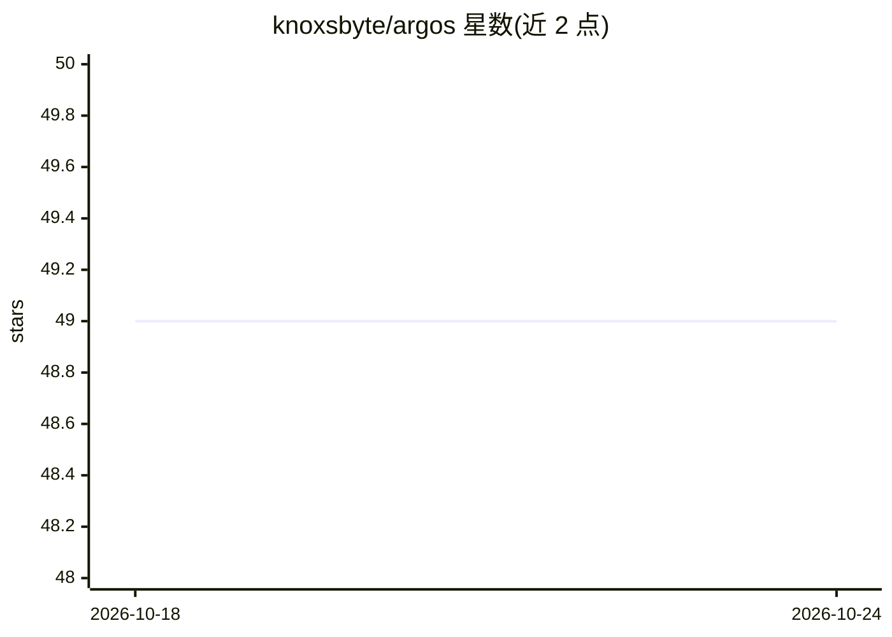

# knoxsbyte/argos

⭐ 49 · Python · 推送 2026-05-27 · [GitHub](https://github.com/knoxsbyte/argos) · 个人维护

**多台 Unitree G1 人形机器人协同自主清扫房间的端到端框架**

面向 Unitree G1 人形机器人的群体协同框架：多台机器人分区并行清扫，双臂/多机任务（铺床、搬家具）通过 PEFA 协议同步执行；采用拍卖式任务分配（按距离/电量/负载计价）与 Claude API 将自然语言目标分解为任务 DAG。含视频训练管线（姿态估计→LeRobot HDF5→LoRA 微调 OpenVLA/Diffusion Policy/ACT）与 MuJoCo 仿真，所有硬件与 ML 依赖可选，缺失时自动进入 mock 模式。提供 Textual TUI 舰队监控面板。

## 筛选速览

| 维度 | 判定 | 备注 |
|---|---|---|
| AI 角色 | `ai-native` | 本体是模型或模型工具 |
| 许可风险 | `none` | — |
| 部署形态 | `library` | 以包/库形式分发 |
| 模型依赖 | locked-api |  |
| 硬件要求 | — | 无带数字的原话,不猜 |
| 安装摩擦 | `low` | 无编译、无系统依赖或容器化 |
| 成熟度 | — | 结构信号不足 |

## 能力要点

- 拍卖式 MRTA 任务分配与 PEFA 多机同步协议
- 清扫视频→LeRobot HDF5→LoRA 微调的三种策略架构训练管线
- Claude 驱动的自然语言任务 DAG 分解
- MuJoCo 仿真与全 mock 回退，无 GPU/硬件也可运行

## 适用场景

- 让 2 台以上 Unitree G1 分区并行清扫并协同完成铺床等双手机任务
- 用自己录制的清扫演示视频微调机器人操作策略
- 在 MuJoCo 仿真中先验证策略再部署到真机

## 场景标签

`微调` · 领域:训练与推理

## 证据(README 行号)

> L11: - **Video-based ML training** — ingest cleaning footage → pose estimation → LeRobot HDF5 dataset → LoRA fine-tuning
> L134: |**OpenVLA**|Language-conditioned tasks (`sort_items`, `organize_shelf`)|7B (LoRA)|~3h / 10 epochs|

## 星数曲线

2026-10-18 49 → 2026-10-24 49（+0）

---
*卡片 v1 · prompt 1.4 · 生成 2026-10-24 · 置信度 high · 依据 README sha `d4c8d79afa2b` · [字段定义](../../DATASET.md)*
