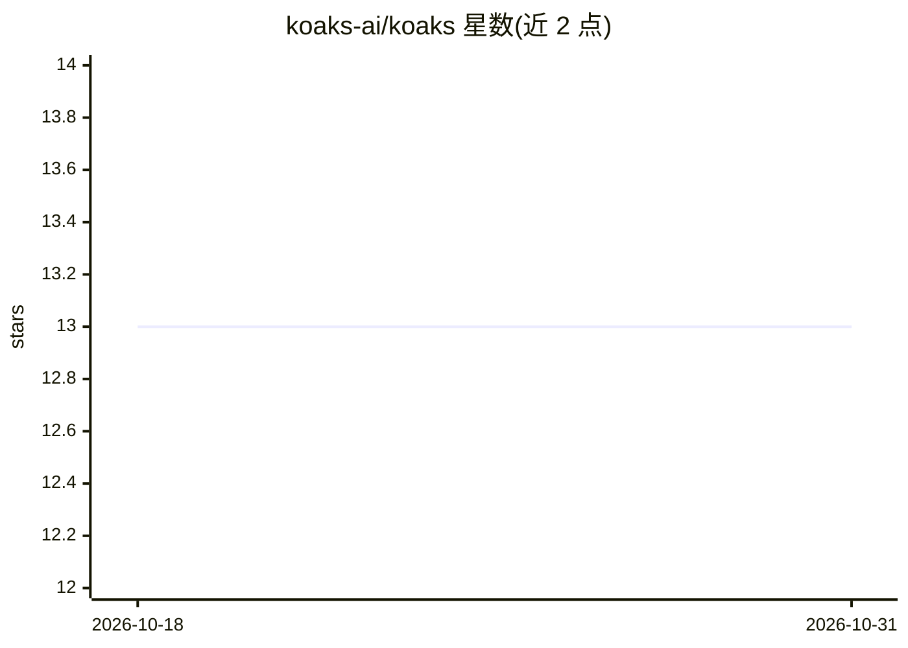

# koaks-ai/koaks

⭐ 13 · Kotlin · Apache-2.0 · 推送 2026-09-09 · [GitHub](https://github.com/koaks-ai/koaks) · 组织维护 · 中文 README

**面向 Kotlin Multiplatform 的声明式 Agent 开发框架**

Koaks 是用 Kotlin Multiplatform 编写的 Agentic AI 框架，以 `agent { }` 声明式 DSL 组装不可变、可复用的 Agent，覆盖 JVM、JS 与 macOS (Apple Silicon)。提供类型化工具定义（JSON Schema 由 @Serializable 类派生）、类工具、JVM @Tool 注解与 MCP 懒发现；支持 SKILL.md 目录加载技能、滑动窗口/摘要式记忆、结构化输出 agent.run<T>()、流式事件、模型回退与预算控制等。通过 Gradle/Maven 引入 org.koaks 构件，需 Kotlin 2.x 与 JDK 21+，LLM 端点可接任意 OpenAI 兼容提供商或本地 Ollama。README 声明项目处于快速迭代期，API 可能随时变化。

## 筛选速览

| 维度 | 判定 | 备注 |
|---|---|---|
| AI 角色 | `ai-ecosystem` | LLM/agent 周边工具 |
| 许可风险 | `permissive` | Apache-2.0 |
| 部署形态 | `None` |  |
| 模型依赖 | local-ok | 支持本地模型 |
| 硬件要求 | — | 无带数字的原话,不猜 |
| 安装摩擦 | `medium` | 含编译或系统依赖之一 |
| 成熟度 | `idea` | |

## 能力要点

- `agent { }` 声明式 DSL 组装不可变、可复用 Agent
- 类型化工具定义，JSON Schema 由 @Serializable 类派生，支持 MCP 懒发现
- SKILL.md 目录加载可复用技能与懒只读资源
- 结构化输出 agent.run<T>() 返回类型化解码结果
- 模型回退、错误策略、步骤/token 预算与人工审批等韧性机制

## 适用场景

- 在 Kotlin/Java 项目中构建带工具调用的 LLM Agent
- 多轮对话 Agent 开发（记忆、线程、子任务 spawn）
- 通过 MCP 网关接入外部工具集
- 跨 JVM/JS/macOS 平台复用同一套 Agent 代码

## 场景标签

`Agent 框架` · 领域:Agent 开发

## 证据(README 行号)

> L13: - **One declarative DSL**: `agent { }` assembles an immutable, reusable agent.
> L20: - **Kotlin Multiplatform**: JVM, JS, and macOS (Apple Silicon) from a single codebase.

## 星数曲线

2026-10-18 13 → 2026-10-31 13（+0）

---
*卡片 v1 · prompt 1.4 · 生成 2026-10-31 · 置信度 high · 依据 README sha `8fb44a18a016` · [字段定义](../../DATASET.md)*
