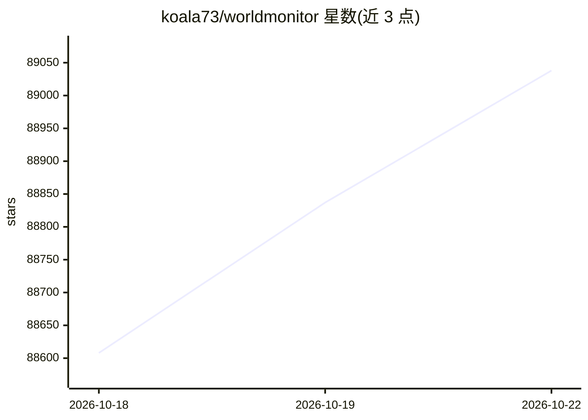

# koala73/worldmonitor

⭐ 89,038 · TypeScript · AGPL-3.0 · 推送 2026-10-21 · [GitHub](https://github.com/koala73/worldmonitor) · [官网](https://worldmonitor.app) · 个人维护 · 中文 README

**实时全球情报仪表盘：新闻聚合、地缘政治与基础设施监控**

以 TypeScript 编写的实时全球态势感知仪表盘，聚合新闻、金融、能源、气候、航空、网络、军事等多源数据，提供 3D 地球与 WebGL 平面图双地图引擎、国家不稳定指数（CII）、跨流信号关联，并由 AI 将新闻源合成为简报。交付形态包括 Web 应用、Tauri 桌面应用（Windows/macOS/Linux）、npm 终端仪表盘与 CLI、Python/Ruby/Go SDK 及 MCP 服务器。支持用 Ollama 本地运行 AI 功能，无需 API key。许可为 AGPL-3.0-only。

## 筛选速览

| 维度 | 判定 | 备注 |
|---|---|---|
| AI 角色 | `ai-enhanced` | 去掉 AI 部分产品仍成立 |
| 许可风险 | `viral` | AGPL-3.0 |
| 部署形态 | `library` | 以包/库形式分发 |
| 模型依赖 | local-ok | 支持本地模型 |
| 硬件要求 | — | 无带数字的原话,不猜 |
| 安装摩擦 | `low` | 无编译、无系统依赖或容器化 |
| 成熟度 | — | 结构信号不足 |

## 动量与使用信号

- 维护:`active` — 距上次 push 0.6 天,年发版 45,160 位贡献者
- 涨星:近 1 天 **+79**(自 20261016 起算)
- 安装:pypi 包 `worldmonitor-sdk` 月下载 669
- 平台:WINDOWS / MACOS / LINUX / WEB · 协议:MCP / OLLAMA

## 能力要点

- 多形态交付：Web、Tauri 桌面应用、终端仪表盘、CLI、三种语言 SDK 与 MCP 服务器
- 3D 地球（globe.gl）与 WebGL 平面图（deck.gl）双地图引擎
- 31 个 Tier-1 国家的国家不稳定指数（CII v11）实时评分
- 支持 Ollama 本地运行 AI，无需 API key

## 适用场景

- 在一个界面里持续跟踪全球新闻、地缘政治与基础设施动态
- 通过终端仪表盘在 shell 中查看地图、新闻、市场与冲突信号
- 用 MCP/REST/SDK 把全球情报数据接入 agent 与脚本

## 场景标签

 · 领域:情报/态势监控

## 证据(README 行号)

> L5: **Real-time global intelligence dashboard** — AI-powered news aggregation, geopolitical monitoring, and infrastructu
> L56: - **Curated news feeds** across global and regional categories, AI-synthesized into briefs
> L62: - **Local AI** — run everything with Ollama, no API keys required

## 星数曲线

2026-10-18 88,608 → 2026-10-22 89,038（+430）

---
*卡片 v1 · prompt 1.4 · 生成 2026-10-20 · 置信度 mid · 依据 README sha `f242488965fc` · [字段定义](../../DATASET.md)*
