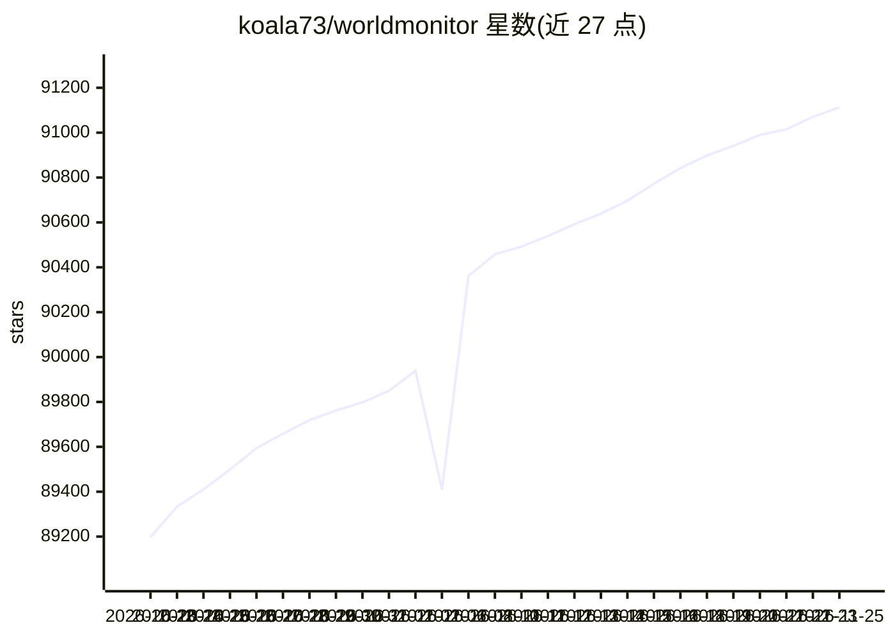

# koala73/worldmonitor

⭐ 91,113 · TypeScript · AGPL-3.0 · 推送 2026-11-23 · [GitHub](https://github.com/koala73/worldmonitor) · [官网](https://worldmonitor.app) · 个人维护 · 中文 README

**实时全球情报仪表盘：AI 新闻聚合与地缘监控**

实时全球情报仪表盘，聚合新闻、地缘政治、金融、军事、气候与网络信号，AI 将策展新闻流合成简报，并提供 31 国不稳定指数、跨流信号关联分析。交付形态包括 Web 应用（六个站点变体）、Tauri 桌面端、终端仪表盘、CLI、MCP server 与 Python/Ruby/Go SDK，面向 OSINT/情报分析使用者。本地 AI 通过 Ollama 运行无需 API key，也可接 OpenRouter；本地开发需 Node.js 24。

## 筛选速览

| 维度 | 判定 | 备注 |
|---|---|---|
| AI 角色 | `ai-enhanced` | 去掉 AI 部分产品仍成立 |
| 许可风险 | `viral` | AGPL-3.0 |
| 部署形态 | `library` | 以包/库形式分发 |
| 模型依赖 | local-ok | 支持本地模型 |
| 硬件要求 | — | 无带数字的原话,不猜 |
| 安装摩擦 | `low` | 无编译、无系统依赖或容器化 |
| 成熟度 | — | 结构信号不足 |

## 动量与使用信号

- 维护:`active` — 距上次 push 0.6 天,年发版 45,160 位贡献者
- 涨星:近 1 天 **+79**(自 20261016 起算)
- 安装:pypi 包 `worldmonitor-sdk` 月下载 669
- 平台:WINDOWS / MACOS / LINUX / WEB · 协议:MCP / OLLAMA

## 能力要点

- 新闻流 AI 合成简报与跨流信号关联（军事/经济/灾害/升级）
- 本地 AI 经 Ollama 运行，无需 API key
- MCP server 与官方 CLI、Python/Ruby/Go SDK 提供程序化访问
- 双地图引擎：globe.gl 3D 地球与 deck.gl WebGL 平面地图

## 适用场景

- 实时监控全球新闻与地缘政治动态生成情报简报
- 跟踪军事航班、冲突与灾害信号的交叉汇聚
- 通过 MCP 或 SDK 把全球情报数据接入 agent 与脚本

## 场景标签

 · 领域:情报/OSINT 数据聚合

## 证据(README 行号)

> L5: **Real-time global intelligence dashboard** — AI-powered news aggregation, geopolitical monitoring, and infrastructu
> L64: - **Local AI** — run everything with Ollama, no API keys required
> L135: World Monitor is built for agents and scripts as well as browsers:

## 星数曲线

2026-10-23 89,198 → 2026-11-25 91,113（+1,915）

---
*卡片 v1 · prompt 1.4 · 生成 2026-11-22 · 置信度 high · 依据 README sha `bccf76f97cfa` · [字段定义](../../DATASET.md)*
