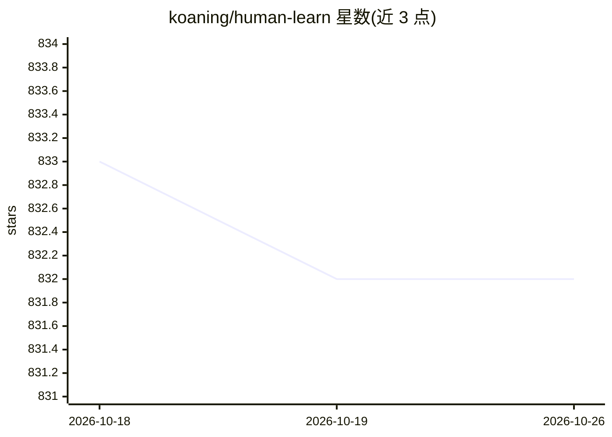

# koaning/human-learn

⭐ 832 · Jupyter Notebook · MIT · 推送 2026-03-09 · [GitHub](https://github.com/koaning/human-learn) · [官网](https://koaning.github.io/human-learn/) · 个人维护

**给 ML 用户的规则系统构建与基准库（scikit-learn 兼容）**

提供与 scikit-learn 兼容的工具，用于构建和基准测试由人设计的规则系统，也可与 ML 模型组合使用。包含函数式模型（FunctionClassifier/FunctionRegressor/FunctionOutlierDetector）、在图表上手工绘制决策边界的交互式模型（InteractiveClassifier 等，基于 bokeh，用 shaply 做点在多边形内判断）、PipeTransformer/InteractivePreprocessor 预处理工具，并内置 Titanic 与 Fish 演示数据集。通过 pip 安装，依赖 scikit-learn 与 pandas。

## 筛选速览

| 维度 | 判定 | 备注 |
|---|---|---|
| AI 角色 | `ai-ecosystem` | LLM/agent 周边工具 |
| 许可风险 | `permissive` | MIT |
| 部署形态 | `library` | 以包/库形式分发 |
| 模型依赖 | — | README 未给出锁定关系 |
| 硬件要求 | — | 无带数字的原话,不猜 |
| 安装摩擦 | `low` | 无编译、无系统依赖或容器化 |
| 成熟度 | — | 结构信号不足 |

## 能力要点

- 函数式分类/回归/离群点检测模型，函数参数可进网格搜索
- 在交互式图表上绘制决策边界并导出为 scikit-learn 兼容模型
- 函数式与交互式预处理工具（支持 pandas .pipe）
- 内置 Titanic、Fish 演示数据集

## 适用场景

- 用手工规则系统给机器学习模型做基准对照
- 通过在图表上画边界快速构建规则分类器/离群检测器
- 把自定义函数封装进 scikit-learn 流水线做网格搜索

## 场景标签

`模型评测` · 领域:评测与运维

## 证据(README 行号)

> L23: This package contains scikit-learn compatible tools that should make it easier
> L24: to construct and benchmark rule based systems that are designed by humans. You
> L25: can also use it in combination with ML models.

## 星数曲线

2026-10-18 833 → 2026-10-26 832（-1）

---
*卡片 v1 · prompt 1.4 · 生成 2026-10-21 · 置信度 high · 依据 README sha `248109b05cd9` · [字段定义](../../DATASET.md)*
