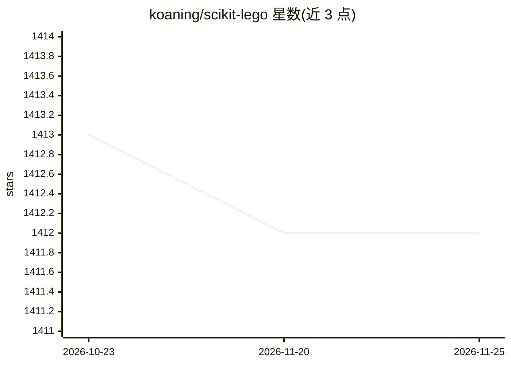

# koaning/scikit-lego

⭐ 1,412 · Python · MIT · 推送 2026-11-14 · [GitHub](https://github.com/koaning/scikit-lego) · [官网](https://koaning.github.io/scikit-lego/) · 组织维护

**给 scikit-learn 用户提供额外的 transformers/模型/指标组件库**

面向 scikit-learn 用户的补充组件包：提供自定义 transformers、metrics、模型与 meta-estimator，按 scikit-learn 接口规范实现，可像 sklearn 组件一样导入并用于 Pipeline。功能覆盖数据集加载、公平性约束分类器（DemographicParity/EqualOpportunity）、GMM 分类与离群检测、分组与时间序列交叉验证、调试 pipeline 等。该项目由荷兰多家公司协作发起，与 scikit-learn 项目无官方隶属关系。支持 pip 与 conda 安装。

## 筛选速览

| 维度 | 判定 | 备注 |
|---|---|---|
| AI 角色 | `ai-native` | 本体是模型或模型工具 |
| 许可风险 | `permissive` | MIT |
| 部署形态 | `library` | 以包/库形式分发 |
| 模型依赖 | — | README 未给出锁定关系 |
| 硬件要求 | — | 无带数字的原话,不猜 |
| 安装摩擦 | `low` | 无编译、无系统依赖或容器化 |
| 成熟度 | — | 结构信号不足 |

## 能力要点

- 提供 60 余个符合 scikit-learn 接口的 transformers、模型、meta-estimator 与指标
- 含公平性约束分类器与公平性指标（demographic parity、equal opportunity、p_percent）
- 提供分组/时间序列交叉验证与 DebugPipeline 调试工具
- 内置多个数据集加载与模拟函数

## 适用场景

- 在 sklearn Pipeline 中使用分组建模或时间序列交叉验证
- 训练带公平性约束的分类器并跟踪公平性指标
- 加载内置数据集做教学与实验

## 场景标签

 · 领域:机器学习工具库

## 证据(README 行号)

> L10: We love scikit learn but very often we find ourselves writing
> L51: We offer custom metrics, models and transformers. You can import them just like you would
> L65: - `sklego.datasets.load_abalone` loads in the abalone dataset

## 星数曲线

2026-10-23 1,413 → 2026-11-25 1,412（-1）

---
*卡片 v1 · prompt 1.4 · 生成 2026-11-23 · 置信度 high · 依据 README sha `8a2f2124bdd4` · [字段定义](../../DATASET.md)*
