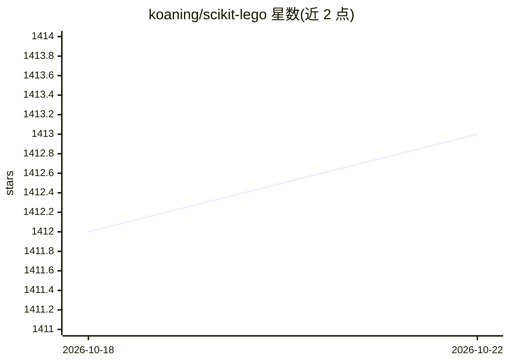

# koaning/scikit-lego

⭐ 1,413 · Python · MIT · 推送 2026-10-15 · [GitHub](https://github.com/koaning/scikit-lego) · [官网](https://koaning.github.io/scikit-lego/) · 组织维护

**为 scikit-learn 流水线提供额外转换器、模型与指标的库**

scikit-lego 收录一批 scikit-learn 未提供的自定义组件：预处理转换器（列选择/去相关/单调样条等）、线性模型（分位数回归、人口平等约束分类器等）、混合模型分类与离群检测器、元模型（分组预测、阈值搜索）、公平性指标、分组时间序列交叉验证与调试流水线，另含多个内置数据集。以 Python 库形式通过 pip 与 conda-forge 安装，由多家荷兰公司发起、全球贡献者参与维护，与 scikit-learn 项目无正式关联。

## 筛选速览

| 维度 | 判定 | 备注 |
|---|---|---|
| AI 角色 | `ai-ecosystem` | LLM/agent 周边工具 |
| 许可风险 | `permissive` | MIT |
| 部署形态 | `library` | 以包/库形式分发 |
| 模型依赖 | — | README 未给出锁定关系 |
| 硬件要求 | — | 无带数字的原话,不猜 |
| 安装摩擦 | `low` | 无编译、无系统依赖或容器化 |
| 成熟度 | — | 结构信号不足 |

## 能力要点

- 提供 50+ 个 scikit-learn 兼容的转换器、模型与指标
- 含公平性约束分类器与公平性评分指标
- 分组时间序列交叉验证（GroupTimeSeriesSplit/TimeGapSplit）
- 内置 8 个示例数据集与 DebugPipeline 调试工具

## 适用场景

- 在现有 sklearn 流水线中直接引入额外的预处理与回归组件
- 构建带公平性约束或公平性评估的分类模型
- 对分组时间序列数据做交叉验证

## 场景标签

 · 领域:机器学习工具库

## 证据(README 行号)

> L10: We love scikit learn but very often we find ourselves writing
> L51: We offer custom metrics, models and transformers. You can import them just like you would

## 星数曲线

2026-10-18 1,412 → 2026-10-22 1,413（+1）

---
*卡片 v1 · prompt 1.4 · 生成 2026-10-21 · 置信度 high · 依据 README sha `6f4644ec4226` · [字段定义](../../DATASET.md)*
