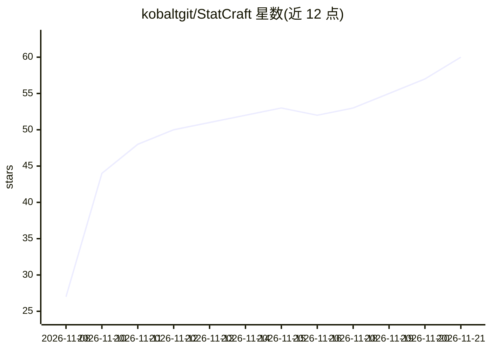

# kobaltgit/StatCraft

⭐ 60 · Rust · Apache-2.0 · 推送 2026-11-20 · [GitHub](https://github.com/kobaltgit/StatCraft) · 个人维护

**纯 Safe Rust 编写的开源统计分析桌面软件，SPSS 风格并带 MCP 接口**

StatCraft 是用 100% Safe Rust 编写的免费开源统计分析软件包，提供 SPSS 风格的桌面 GUI（数据视图、变量字典、透视表输出查看器）与确定性语法分析引擎，覆盖描述统计、频数、三类 T 检验与单因素 ANOVA。面向心理学研究、临床试验、高校统计教学与企业数据集分析。核心机制包括：原子化 EngineCommand（支持 Undo/Redo 并序列化为 .sps 语法）、内置本地 IPC 桥（127.0.0.1:18493）与 MCP 服务器（--mcp），使 Claude、Ollama 等外部 AI agent 可查询元数据、执行批处理语法并实时取回计算结果；所有计算本地完成。需 Rust 1.80+ 从源码编译运行，无预编译安装包说明。

## 筛选速览

| 维度 | 判定 | 备注 |
|---|---|---|
| AI 角色 | `ai-enhanced` | 去掉 AI 部分产品仍成立 |
| 许可风险 | `permissive` | Apache-2.0 |
| 部署形态 | `desktop` | 安装包/桌面程序 |
| 模型依赖 | local-ok | 支持本地模型 |
| 硬件要求 | — | 无带数字的原话,不猜 |
| 安装摩擦 | `low` | 无编译、无系统依赖或容器化 |
| 成熟度 | — | 结构信号不足 |

## 能力要点

- SPSS 风格桌面 GUI 与语法引擎，命令序列化为 .sps 并支持 Undo/Redo
- 内置 MCP 服务器与本地 IPC 桥（端口 18493），外部 AI agent 可双向控制
- 100% Safe Rust，零 unsafe/panic，错误以类型化 Result 返回
- 结果以 TSV 一键导出，可直接粘贴 Excel；EN/RU 双语界面运行时切换

## 适用场景

- 不熟悉 SPSS 语法的研究者用自然语言让 AI agent 代为执行统计检验
- 替代付费统计套件完成教学与科研中的描述统计、T 检验和 ANOVA
- 在本地对医学或企业数据做隐私敏感的统计分析

## 场景标签

`数据分析` · 领域:效率与自动化

## 证据(README 行号)

> L18: **StatCraft** is a free, modern, open-source statistical software package built entirely in **100% pure Safe Rust**
> L30: * **Agent-Ready & MCP Bridge (Code Mode):** Built-in local IPC socket (port 18493) and Model Context Protocol (MCP)
> L78: ### 4. StatCraft Bridge & AI Agents (Model Context Protocol / Code Mode)

## 星数曲线

2026-11-08 27 → 2026-11-21 60（+33）

---
*卡片 v1 · prompt 1.4 · 生成 2026-11-18 · 置信度 high · 依据 README sha `1c9565b98140` · [字段定义](../../DATASET.md)*
