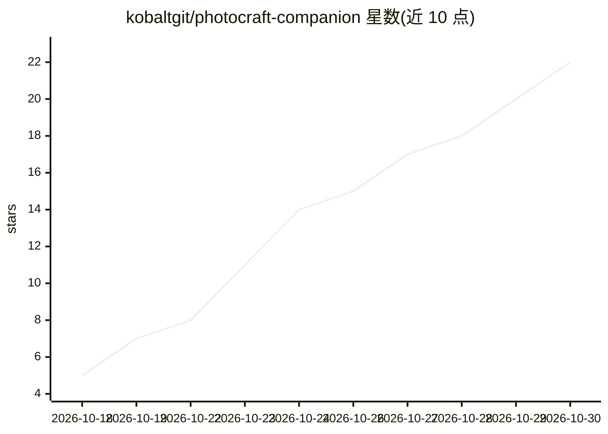

# kobaltgit/photocraft-companion

⭐ 22 · Rust · MIT · 推送 2026-10-29 · [GitHub](https://github.com/kobaltgit/photocraft-companion) · 个人维护 · 中文 README

**为 PhotoCraft 图像编辑器提供本地 AI 神经工具与插件生态的桌面伴侣应用**

Rust + egui 编写的桌面应用，通过本地 JSON-RPC 控制套接字（端口 18492）与 PhotoCraft 图像编辑器通信，在当前画布图层上直接执行 AI 抠图（RMBG-1.4）、生成式填充（LaMa）与 2x 超分（Real-ESRGAN Compact），推理使用 DirectML GPU 加速并支持 CPU 回退。同时提供浮动工具条、声明式 plugin.json 插件引擎、应用内插件市场与 .pcpl 包格式，绕过 PhotoCraft 内置 Wasm 沙箱的 GPU 与存储限制。面向 PhotoCraft 用户，提供 Windows/macOS/Linux 安装包与便携版。

## 筛选速览

| 维度 | 判定 | 备注 |
|---|---|---|
| AI 角色 | `ai-native` | 本体是模型或模型工具 |
| 许可风险 | `permissive` | MIT |
| 部署形态 | `desktop` | 安装包/桌面程序 |
| 模型依赖 | — | README 未给出锁定关系 |
| 硬件要求 | — | 无带数字的原话,不猜 |
| 安装摩擦 | `low` | 无编译、无系统依赖或容器化 |
| 成熟度 | — | 结构信号不足 |

## 能力要点

- 本地 DirectML GPU 推理的 AI 抠图/填充/超分，直接作用于画布当前图层
- 声明式 plugin.json 插件引擎与 .pcpl 包格式，支持热重载
- 应用内插件市场，一键安装 GitHub Releases 上的社区插件
- 模型权重自包含于插件目录，带 SHA-256 校验与下载器

## 适用场景

- 在 PhotoCraft 中一键去除图片背景或放大画布
- 浏览和安装社区 AI 插件扩展编辑器功能
- 通过浮动工具条在画布上方快速调用 AI 工具

## 场景标签

`图像视频处理` · 领域:感知与多模态

## 证据(README 行号)

> L29: - **In-Place Canvas Execution:** Neural background removal, color filters, and custom macro actions execute directl
> L50:  - **AI Remove Background:** Bria AI **RMBG-1.4** (~168 MB) high-precision subject cutout with coordinate preservat
> L53:  - **Resilient AI Runtime:** Hardware-accelerated **DirectML (DirectX 12 GPU)** with automatic transparent fallback

## 星数曲线

2026-10-18 5 → 2026-10-30 22（+17）

---
*卡片 v1 · prompt 1.4 · 生成 2026-10-28 · 置信度 high · 依据 README sha `68732907a9b3` · [字段定义](../../DATASET.md)*
