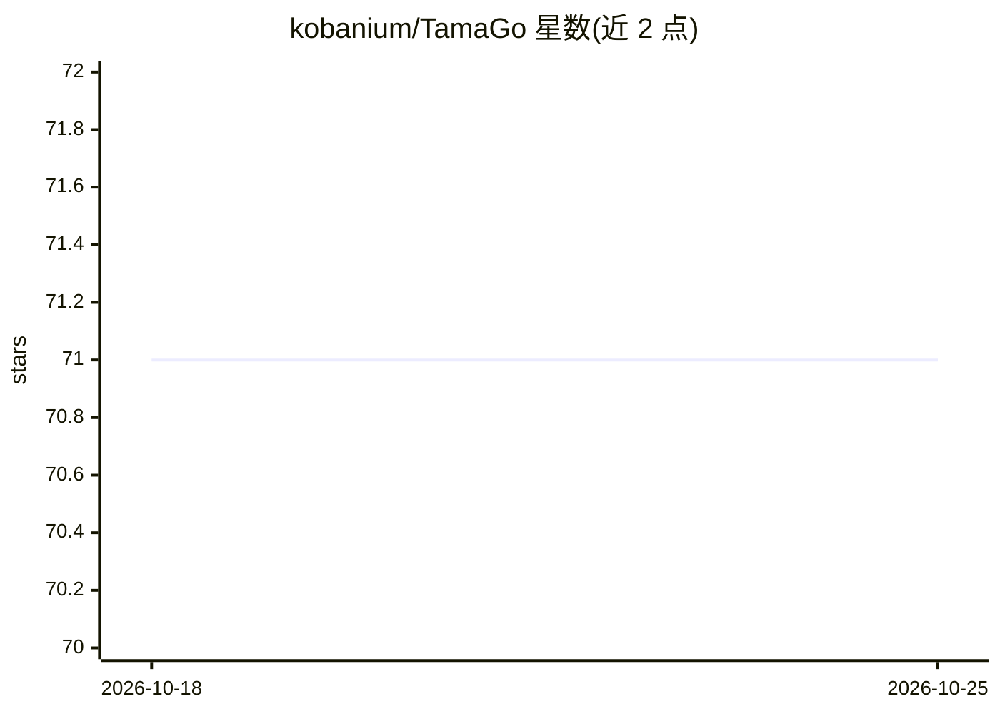

# kobanium/TamaGo

⭐ 71 · Python · Apache-2.0 · 推送 2026-07-06 · [GitHub](https://github.com/kobanium/TamaGo) · 个人维护 · 中文 README

**Python 围棋引擎：MCTS+神经网络走子，支持监督与强化学习**

用 Python 3.11+ 实现的围棋（Weiqi/Baduk）引擎，通过蒙特卡洛树搜索结合训练好的神经网络模型生成着法。提供基于 SGF 文件的监督学习与 Gumbel AlphaZero 方法强化学习两种训练方式；以 GTP（Go Text Protocol）引擎形式运行，可接入支持 GTP 的图形界面，支持 lz-analyze、cgos-analyze 等分析命令及 GoGui/Lizzie/Sabaki。命令行可配置棋盘尺寸、super-ko 规则、每步访问数、思考时间、GPU 使用等；仅用 CPU 也可运行，训练神经网络时建议使用 GPU。以 Apache 2.0 许可发布。

## 筛选速览

| 维度 | 判定 | 备注 |
|---|---|---|
| AI 角色 | `ai-native` | 本体是模型或模型工具 |
| 许可风险 | `permissive` | Apache-2.0 |
| 部署形态 | `library` | 以包/库形式分发 |
| 模型依赖 | — | README 未给出锁定关系 |
| 硬件要求 | `cpu-ok` | |
| 安装摩擦 | `low` | 无编译、无系统依赖或容器化 |
| 成熟度 | — | 结构信号不足 |

## 能力要点

- 监督学习（SGF 文件）与 Gumbel AlphaZero 强化学习
- MCTS + 神经网络生成着法，GTP 协议接入 GUI
- 支持 lz-analyze / cgos-analyze 分析命令与 GoGui Policy 可视化
- 提供 MCTS 搜索树可视化（0.10.0 起）

## 适用场景

- 在支持 GTP 的围棋 GUI 中作为引擎对弈
- 从自己的 SGF 棋谱训练围棋模型并做强化学习
- 在 CGOS 上测试引擎并查看搜索分析信息

## 场景标签

`强化学习` · 领域:训练与推理

## 证据(README 行号)

> L4:  - Supervised learning using SGF-format files.
> L5:  - Reinforcement learning with Gumbel AlphaZero method.
> L6:  - Move generation using Monte-Carlo tree search and a trained neural network model.

## 星数曲线

2026-10-18 71 → 2026-10-25 71（+0）

---
*卡片 v1 · prompt 1.4 · 生成 2026-10-24 · 置信度 mid · 依据 README sha `b2e44b804fc9` · [字段定义](../../DATASET.md)*
