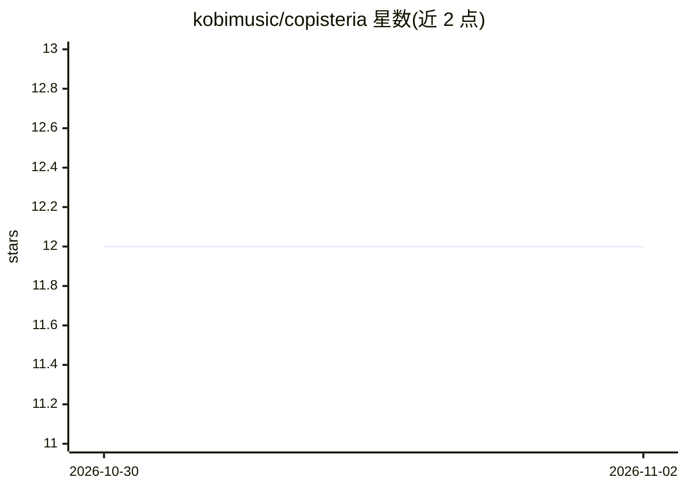

# kobimusic/copisteria

⭐ 12 · Python · Apache-2.0 · 推送 2026-10-29 · [GitHub](https://github.com/kobimusic/copisteria) · 个人维护

**光学乐谱识别读取器：扫描乐谱页面转 MusicXML**

KobiMusic 的 OMR（光学乐谱识别）工具：输入印刷乐谱的扫描页面图像或 PDF，输出 MusicXML、逐符号读取 JSON 与带 Verovio 渲染的 HTML 查看页。核心机制为符号检测器（270 类，copista-28m/2m 两种规模）加 2M 参数的证据 transformer，在整页上下文中读取调号、拍号、节奏与变音记号。面向处理历史扫描版（18-19 世纪）乐谱数字化场景，权重托管在 Hugging Face，需 Python 3.12 与 poppler-utils，以 pip 可编辑安装从仓库根目录运行。

## 筛选速览

| 维度 | 判定 | 备注 |
|---|---|---|
| AI 角色 | `ai-native` | 本体是模型或模型工具 |
| 许可风险 | `permissive` | Apache-2.0 |
| 部署形态 | `library` | 以包/库形式分发 |
| 模型依赖 | — | README 未给出锁定关系 |
| 硬件要求 | — | 无带数字的原话,不猜 |
| 安装摩擦 | `low` | 无编译、无系统依赖或容器化 |
| 成熟度 | — | 结构信号不足 |

## 能力要点

- 检测器（270 类符号）+ 2M 参数证据模型的整页上下文阅读流水线
- 两种规模：copista-28m（30.7M 参数总量）与 copista-2m（4.0M）
- 输出 MusicXML、逐符号读取 JSON 与 Verovio 渲染的 HTML 查看页
- 提供训练代码（31,800 页渲染数据训练）与 OMR-NED 基准测试

## 适用场景

- 把扫描的老版印刷乐谱数字化为 MusicXML
- 批量处理 PDF 乐谱集（--pdf --range）并核对每页读取证据
- 对比各 OMR 系统在同一基准上的错误率

## 场景标签

`文档解析` · 领域:知识与检索

## 证据(README 行号)

> L11: KobiMusic's **copisteria** optical music recognition reader: a scanned page of sheet music in, MusicXML out. Instea
> L17: copisteria is the evidence model and the reader around it; the symbols come from a **copista** model's detector, in

## 星数曲线

2026-10-30 12 → 2026-11-02 12（+0）

---
*卡片 v1 · prompt 1.4 · 生成 2026-11-01 · 置信度 high · 依据 README sha `5f88bab82502` · [字段定义](../../DATASET.md)*
