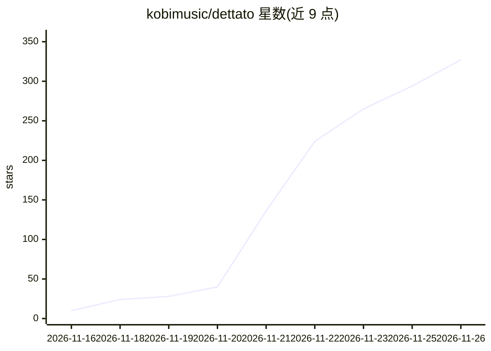

# kobimusic/dettato

⭐ 327 · Python · Apache-2.0 · 推送 2026-11-22 · [GitHub](https://github.com/kobimusic/dettato) · [官网](https://huggingface.co/collections/kobimusic/dettato) · 个人维护

**给音频录音自动转录为多乐器 MIDI 文件的工具**

命令行与 Python 库形式的音频到 MIDI 转录器：输入任意录音，输出按乐器分轨并含鼓轨的 MIDI 文件与 JSON 元数据。内部为四模型链路（15.3M 转录器、4.9M 证据修复器、2.9M 分轨器、5.0M 鼓模型），共 28.1M 参数，权重 Apache-2.0 并经 Hugging Face Hub 首次运行时下载，训练数据不含受版权录音。支持 CUDA/MPS/CPU 三种设备，README 说明分轨是较弱环节、非量化到节拍，并给出九个公开基准上的分数表。

## 筛选速览

| 维度 | 判定 | 备注 |
|---|---|---|
| AI 角色 | `ai-native` | 本体是模型或模型工具 |
| 许可风险 | `permissive` | Apache-2.0 |
| 部署形态 | `library` | 以包/库形式分发 |
| 模型依赖 | — | README 未给出锁定关系 |
| 硬件要求 | — | 无带数字的原话,不猜 |
| 安装摩擦 | `medium` | 含编译或系统依赖之一 |
| 成熟度 | — | 结构信号不足 |

## 能力要点

- 四模型链路：转录、证据修复、乐器分轨、鼓检测，可单独调用各阶段
- 输出性能 MIDI（保留录音时值，不量化到节拍）与 JSON 元数据（调音估计、鼓模型信息）
- 递归扫描文件夹批量转录，自动按原目录结构输出
- 代码与权重均为 Apache-2.0，权重可经 DETTATO_WEIGHTS 离线加载

## 适用场景

- 把整张文件夹里的录音批量转成按乐器分轨的 MIDI
- 做音乐信息检索研究时用 88 键 onset/frame/offset 输出做下游处理
- 鼓轨与编队打击乐的自动检测与转写
- 需要可离线、可商用的转录流水线时本地运行模型权重

## 场景标签

 · 领域:音频/音乐信息检索

## 证据(README 行号)

> L11: KobiMusic's **dettato** is an audio to MIDI transcriber. You give it a recording and it writes a MIDI file, with on
> L17: dettato is four models in a chain. The transcriber (15.3M parameters) finds the notes. The evidence repairer (4.9M)
> L89: - Uses the GPU when there is one: CUDA, else Apple silicon's MPS (`--device cpu` to force the CPU).

## 星数曲线

2026-11-16 10 → 2026-11-26 327（+317）

---
*卡片 v1 · prompt 1.4 · 生成 2026-11-25 · 置信度 high · 依据 README sha `38a870d481c8` · [字段定义](../../DATASET.md)*
