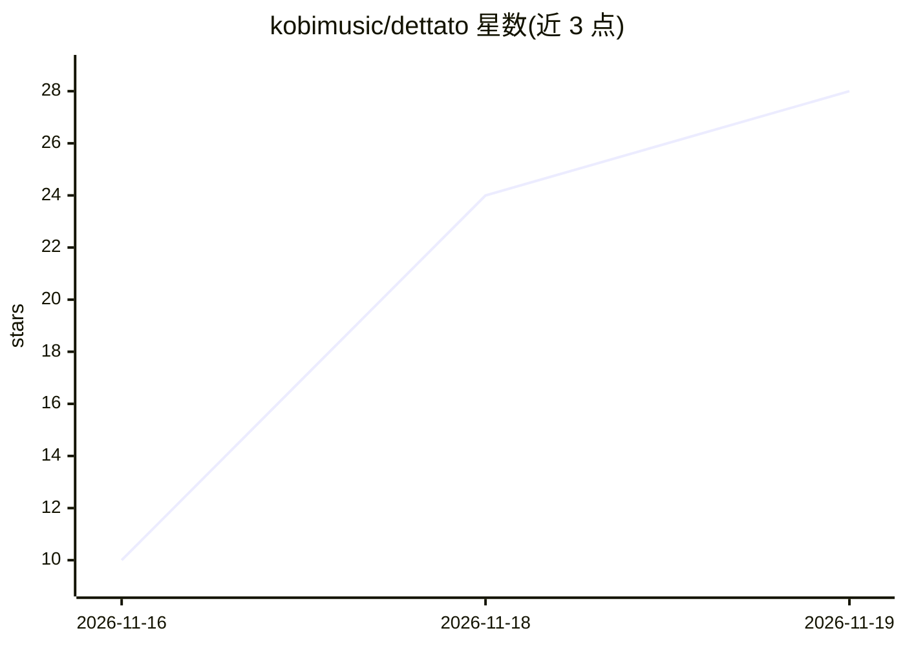

# kobimusic/dettato

⭐ 28 · Python · Apache-2.0 · 推送 2026-11-17 · [GitHub](https://github.com/kobimusic/dettato) · [官网](https://huggingface.co/collections/kobimusic/dettato) · 个人维护

**多乐器音频转 MIDI 转录器：从录音生成按乐器分轨的 MIDI**

KobiMusic 的音频转 MIDI 工具：输入录音文件，输出含每件乐器一轨加鼓轨的 MIDI 文件与 JSON 信息。管线由四个模型组成（转录器 15.3M 找音符、证据修复器 4.9M 修音符、分组器 2.9M 分乐器轨道、鼓模型 5.0M），共 28.1M 参数，权重托管在 Hugging Face Hub。提供 CLI 与 Python API，支持批量处理与离线权重加载。限制：音域覆盖 88 键、同键最多双音，乐器归属在爵士等场景约四分之一萨克斯音符会落入钢琴轨，低于 40 kHz 音源跳过鼓轨。代码与权重 Apache-2.0。

## 筛选速览

| 维度 | 判定 | 备注 |
|---|---|---|
| AI 角色 | `ai-native` | 本体是模型或模型工具 |
| 许可风险 | `permissive` | Apache-2.0 |
| 部署形态 | `library` | 以包/库形式分发 |
| 模型依赖 | — | README 未给出锁定关系 |
| 硬件要求 | — | 无带数字的原话,不猜 |
| 安装摩擦 | `medium` | 含编译或系统依赖之一 |
| 成熟度 | — | 结构信号不足 |

## 能力要点

- 四模型链式管线：转录→证据修复→乐器分组→鼓轨，共 28.1M 参数
- 输出按乐器分轨的 MIDI 与 JSON（轨道、音符数、调音估计）
- 权重从 Hugging Face Hub 自动下载，可设 DETTATO_WEIGHTS 离线加载
- GPU 加速：RTX 5060 上 5 分钟歌曲约 40 秒、峰值显存低于 4 GB

## 适用场景

- 把录音转成分乐器轨道的 MIDI 用于编曲或编辑
- 批量处理文件夹中的音频并保留目录结构导出 MIDI
- 在无网络环境离线加载权重做转录

## 场景标签

 · 领域:音乐信息检索/音频转录

## 证据(README 行号)

> L11: KobiMusic's **dettato** is an audio to MIDI transcriber. You give it a recording and it writes a MIDI file, with on
> L74: |1|kobimusic/dettato|15.3M|notes from audio: onset, end and pitch on 88 keys, two voices per key|

## 星数曲线

2026-11-16 10 → 2026-11-19 28（+18）

---
*卡片 v1 · prompt 1.4 · 生成 2026-11-18 · 置信度 high · 依据 README sha `a4ed3a786319` · [字段定义](../../DATASET.md)*
