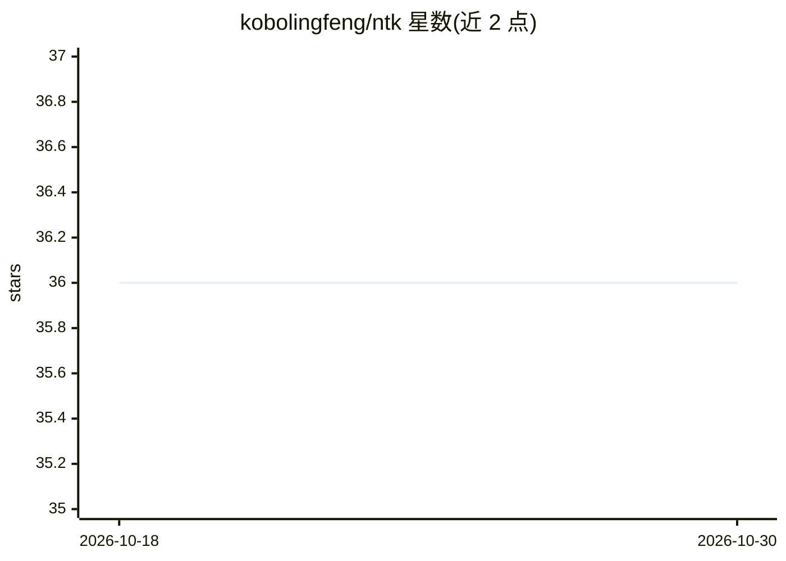

# kobolingfeng/ntk

⭐ 36 · TypeScript · MIT · 推送 2026-04-13 · [GitHub](https://github.com/kobolingfeng/ntk) · 个人维护 · 中文 README

**按信息密度路由的 token 节省型多智能体框架**

TypeScript 实现的多 Agent 框架，核心机制是按任务复杂度自适应路由：正则快速路径（内部测试集约 63% 任务零 LLM 分级）+ 轻量 LLM 分类器，将任务分入 direct/light/standard/full 四级管线深度；5 类 Agent 按信息密度分工，仅规划步骤使用强模型，其余走廉价模型。配套确定性预过滤（7 种策略零 token 成本）、选择性遗忘压缩与 Tee 压缩回溯机制。原生支持 MCP 协议，可接入 VS Code Copilot、Claude Desktop、OpenClaw 等客户端；需自备 OpenAI 兼容 API 端点，不内置 API Key。AGPL-3.0 许可。

## 筛选速览

| 维度 | 判定 | 备注 |
|---|---|---|
| AI 角色 | `ai-ecosystem` | LLM/agent 周边工具 |
| 许可风险 | `permissive` | MIT |
| 部署形态 | `library` | 以包/库形式分发 |
| 模型依赖 | local-ok | 支持本地模型 |
| 硬件要求 | — | 无带数字的原话,不猜 |
| 安装摩擦 | `low` | 无编译、无系统依赖或容器化 |
| 成熟度 | — | 结构信号不足 |

## 能力要点

- 自适应复杂度路由：正则快速路径 + LLM 分类器，四级管线深度（direct→light→standard→full）
- 双模型成本分离：仅规划步骤用强模型，其余走廉价模型
- 7 种确定性预过滤策略（零 token 成本）+ 智能输出类型检测
- Tee 压缩回溯机制：验证失败时恢复原始文本重新执行
- MCP 协议原生支持，提供 ntk_run/ntk_run_fast/ntk_compress 三个工具

## 适用场景

- 在 VS Code Copilot 或 Claude Desktop 中通过 MCP 接入以降低 token 消耗
- 让简单任务绕过复杂多 Agent 管线一步直出，控制成本
- OpenClaw 用户减少对话中的 token 用量
- 以 HTTP API 或 CLI 方式运行自适应任务执行管线

## 场景标签

`Agent 框架` `多智能体` · 领域:Agent 开发

## 证据(README 行号)

> L24: 军事情报领域有一个原则叫 "Need-to-Know Basis"——即使你有最高安全权限，你也只会被告知完成任务所必须知道的最小信息集。NTK 把这个原则带进了多Agent系统：
> L144: NTK 原生支持 MCP 协议，可直接接入 VS Code Copilot、Claude Desktop、OpenClaw 等任何支持 MCP 的客户端。
> L264: npx tsx src/cli.ts serve --port 3210          # HTTP API 服务

## 星数曲线

2026-10-18 36 → 2026-10-30 36（+0）

---
*卡片 v1 · prompt 1.4 · 生成 2026-10-25 · 置信度 high · 依据 README sha `41eb9c8ac675` · [字段定义](../../DATASET.md)*
