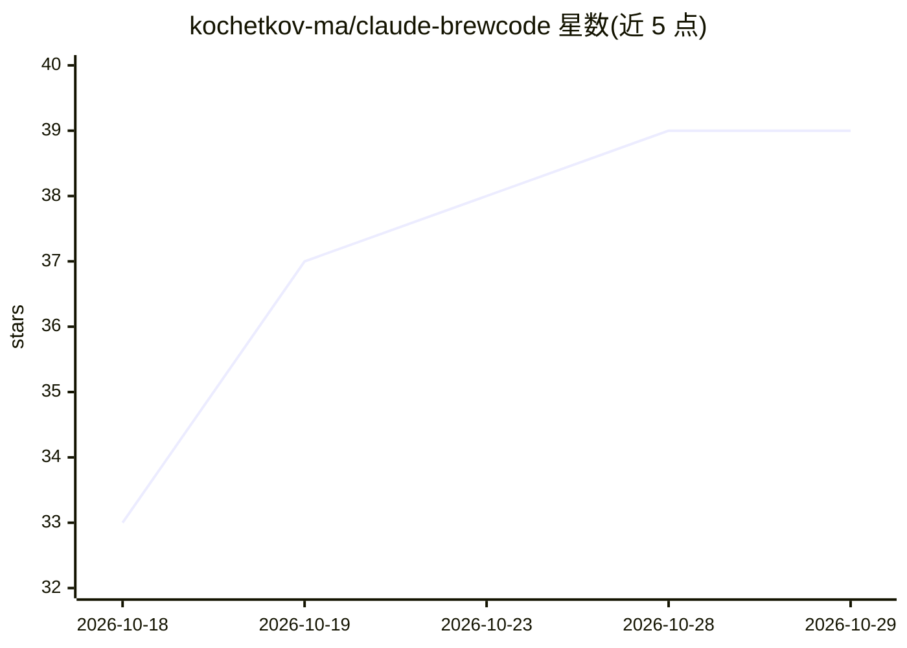

# kochetkov-ma/claude-brewcode

⭐ 39 · JavaScript · MIT · 推送 2026-10-27 · [GitHub](https://github.com/kochetkov-ma/claude-brewcode) · [官网](https://doc-claude.brewcode.app/) · 个人维护

**Claude Code 插件套件：技能/代理编写、评审、文档同步与工具集**

面向 Claude Code 用户的插件套件，含 4 个插件、27 个技能、10 个代理：brewcode 提供 skill/agent/rule 的创建与同步命令、semble 语义代码搜索、按项目生成领域子代理团队与深度评审技能；brewdoc 提供文档同步 hooks、记忆同步、Markdown 转 PDF 与发布到公开链接；brewtools 提供文本压缩、secrets 扫描、SSH/部署、主会话硬墙与子代理预算守卫等。另有 3 个 mods：占位符（++r 审查块）、计划模式提升 effort、跨会话文件提醒。安装经 claude plugin 市场命令，需 Claude Code 2.1.301 或更新版本及 node。

## 筛选速览

| 维度 | 判定 | 备注 |
|---|---|---|
| AI 角色 | `ai-ecosystem` | LLM/agent 周边工具 |
| 许可风险 | `permissive` | MIT |
| 部署形态 | `library` | 以包/库形式分发 |
| 模型依赖 | — | README 未给出锁定关系 |
| 硬件要求 | — | 无带数字的原话,不猜 |
| 安装摩擦 | `low` | 无编译、无系统依赖或容器化 |
| 成熟度 | `idea` | |

## 能力要点

- 以相同命令创建/改进/同步 skill 与 agent（skill-creator、agent-creator）
- 按项目生成六段式领域代理团队与 intent-guard 审查代理
- docsync 三 hooks 追踪 .md 编辑并在过期时阻断要求同步
- secrets 扫描、token 压缩、子代理时限/报告预算守卫与任务板

## 适用场景

- 我在 Claude Code 中想给 prompt 挂可复用的审查/管理占位符
- 我想让 AI 代理按领域分工并受预算与路由守卫约束
- 我需要项目文档被追踪并在过期时强制同步
- 我想把生成结果快速发布为公开链接分享

## 场景标签

`提示工程` `代码审查` · 领域:Agent 开发

## 证据(README 行号)

> L12: **Claude Code plugin suite.** Keeps big tasks on track: bounded units, a six-field brief per spawn, the plan re-anc
> L160: |brewcode|Authoring toolkit: skill, agent and rule creation and sync, semantic search (semble), conventions, E2E t
> L162: |brewtools|Text optimization, secrets scanning, SSH and deploy, manager hard wall, subagent guards, task board, co

## 星数曲线

2026-10-18 33 → 2026-10-29 39（+6）

---
*卡片 v1 · prompt 1.4 · 生成 2026-10-25 · 置信度 mid · 依据 README sha `0c37d3b67edb` · [字段定义](../../DATASET.md)*
