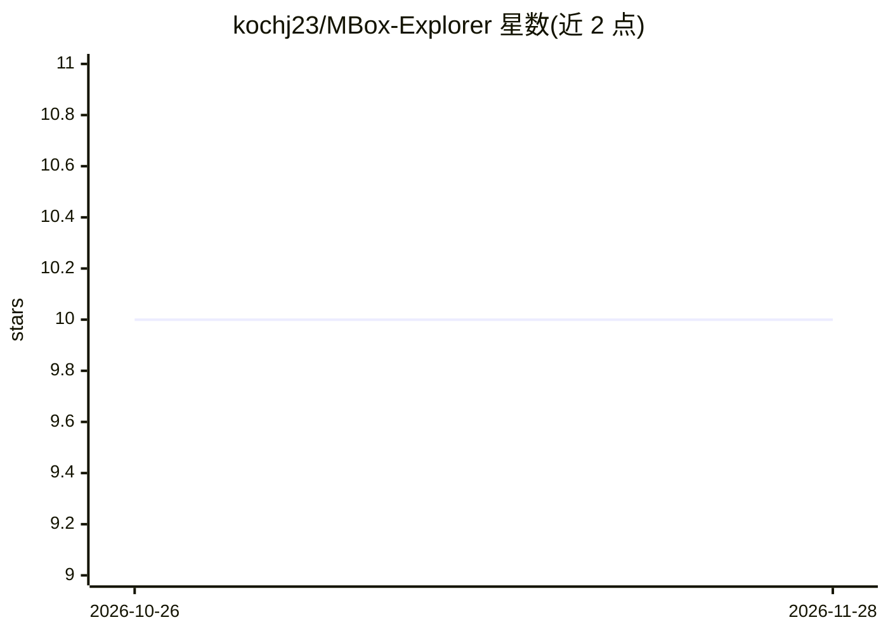

# kochj23/MBox-Explorer

⭐ 10 · Swift · MIT · 推送 2026-11-12 · [GitHub](https://github.com/kochj23/MBox-Explorer) · [官网](https://github.com/kochj23/MBox-Explorer) · 个人维护

**给 macOS 用户的本地邮件归档浏览器：导入、检索与可选 AI 问答**

面向 macOS 的邮件归档探索器，将 MBOX/EML/EMLX/MSG/Gmail Takeout 解析为可搜索、按线程组织的界面，提供流式解析与解析缓存。在此之上叠加 RAG 问答（Ask）、多轮会话、摘要与一系列分析工具，AI 由 NovaAIKit 层驱动，后端按链式降级（本地优先），API key 仅存于 Keychain。每个 AI 功能都有内置非 AI 回退结果，关闭 AI 时一切功能仍可用。提供 DMG 安装包，也可用 Xcode 从源码构建。

## 筛选速览

| 维度 | 判定 | 备注 |
|---|---|---|
| AI 角色 | `ai-enhanced` | 去掉 AI 部分产品仍成立 |
| 许可风险 | `permissive` | MIT |
| 部署形态 | `desktop` | 安装包/桌面程序 |
| 模型依赖 | local-ok | 支持本地模型 |
| 硬件要求 | — | 无带数字的原话,不猜 |
| 安装摩擦 | `medium` | 含编译或系统依赖之一 |
| 成熟度 | — | 结构信号不足 |

## 能力要点

- 多格式导入（MBOX/EML/EMLX/MSG/Gmail Takeout）与流式解析、解析缓存
- RAG 问答与多轮会话，回答附带邮件引用；含数字校验的摘要验证机制
- AI 后端链式降级（本地 Ollama/MLX 优先，云端可选），每个功能均有内置回退
- 语义搜索嵌入与聊天 AI 分离配置；API key 仅存于 macOS Keychain

## 适用场景

- 在本地浏览和检索多年积累的邮件归档
- 对邮件线程做摘要并基于归档内容问答
- 分析邮件中的行动项、会议与人脉关系
- 需要隐私可控的本地 AI 后端处理邮件数据

## 场景标签

`RAG` `语义搜索` `文档问答` · 领域:知识与检索

## 证据(README 行号)

> L16: first, Keychain-only keys, and a built-in (non-AI) result for every feature when AI is off or unreachable.
> L58: - **Use AI** on/off. Off means nothing is sent anywhere and every feature uses its built-in result.

## 星数曲线

2026-10-26 10 → 2026-11-28 10（+0）

---
*卡片 v1 · prompt 1.4 · 生成 2026-11-19 · 置信度 mid · 依据 README sha `e5ace1e20780` · [字段定义](../../DATASET.md)*
