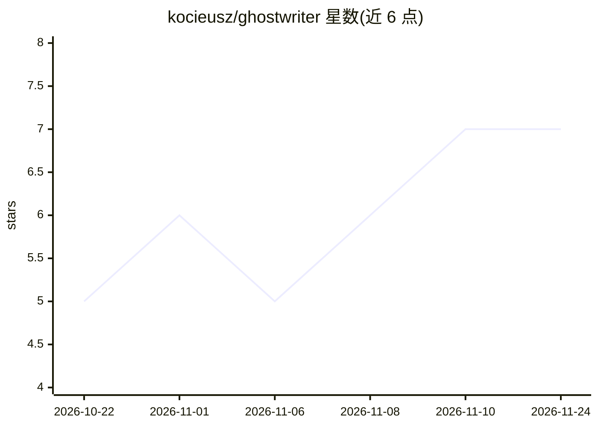

# kocieusz/ghostwriter

⭐ 7 · Go · Apache-2.0 · 推送 2026-11-05 · [GitHub](https://github.com/kocieusz/ghostwriter) · 个人维护

**从你的写作样本学习文风，为 agent 草稿打分**

一个本地运行的 CLI 工具：从用户自己的写作样本（8 篇以上）构建文风画像，对 coding agent 生成的草稿按 0-100 打分，检查项包括声音相似度（约 30 项文体测量）、AI 写作模式（28 类规则）与事实核对（数字/名字/引用需与 brief 一致）。通过线按写作者 individually 校准，未通过的检查以具体备注形式返回给 agent 循环修改。以安装脚本分发单二进制文件，支持 macOS/Linux，可配置多个声音 profile。

## 筛选速览

| 维度 | 判定 | 备注 |
|---|---|---|
| AI 角色 | `ai-native` | 本体是模型或模型工具 |
| 许可风险 | `permissive` | Apache-2.0 |
| 部署形态 | `None` |  |
| 模型依赖 | — | README 未给出锁定关系 |
| 硬件要求 | — | 无带数字的原话,不猜 |
| 安装摩擦 | `low` | 无编译、无系统依赖或容器化 |
| 成熟度 | — | 结构信号不足 |

## 能力要点

- 三项检查打分：声音相似度、AI 写作模式、事实核对
- 通过线按写作者样本逐一校准
- 本地运行，写作样本不出本机
- agent 自动执行写→评分→修改循环，直至通过

## 适用场景

- 让 coding agent 代写邮件/文档时保持我本人的文风
- 检测 AI 草稿中的套话模式与编造的数字、名字
- 为工作与个人写作维护不同的文风 profile

## 场景标签

`AI 写作` · 领域:内容生成

## 证据(README 行号)

> L9: ghostwriter learns how you write from your own samples and scores every draft
> L83: - **AI tells**: 28 families of patterns models overuse, such as "not X but Y",
> L90: AI drafts should not. The agent runs the loop itself (load your voice, write,

## 星数曲线

2026-10-22 5 → 2026-11-24 7（+2）

---
*卡片 v1 · prompt 1.4 · 生成 2026-11-20 · 置信度 high · 依据 README sha `5f0fb0093fba` · [字段定义](../../DATASET.md)*
