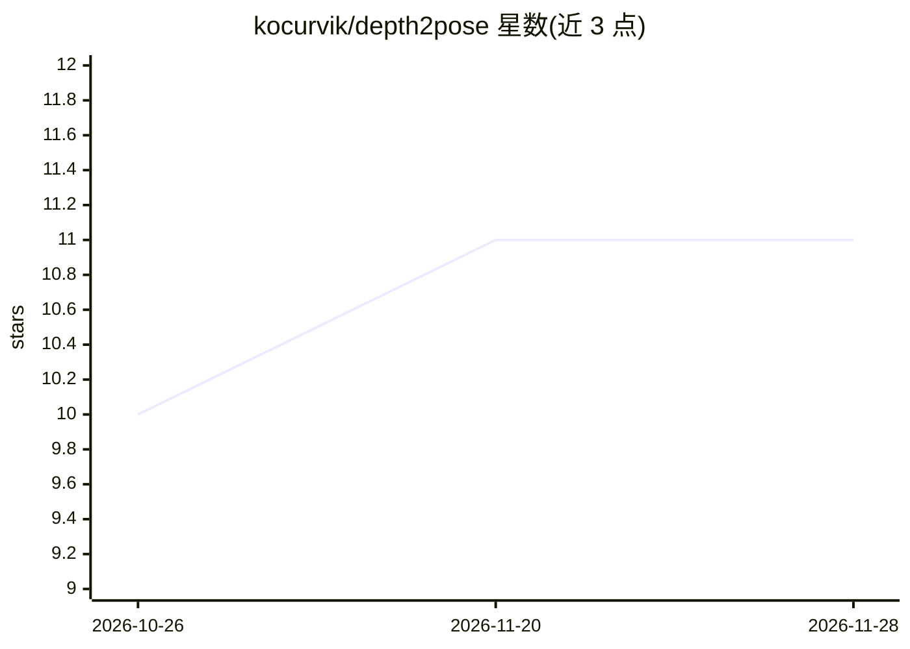

# kocurvik/depth2pose

⭐ 11 · Python · 推送 2026-11-18 · [GitHub](https://github.com/kocurvik/depth2pose) · [官网](https://kocurvik.github.io/depth2pose/) · 组织维护

**科研评测基准：无需深度真值即可评估单目深度估计模型**

NeurIPS 2026 论文的评测代码库，提供 D2P 基准：借助 RePoseD 框架，用双视图相对位姿精度评估单目深度估计器（MDE），仅需可获得 COLMAP 重建的图像集合，无需地面真值深度。提供两条使用路径：单机 GPU 上运行的 eval_my_mde.py 一键评测脚本（下载约 8 GB 数据集、运行 MDE、估计相对位姿并写入结果表），以及面向 SLURM 集群的完整基准流水线。支持通过实现 MyMDE 类接入自己的模型，结果经 pull request 提交到公开结果表。

## 筛选速览

| 维度 | 判定 | 备注 |
|---|---|---|
| AI 角色 | `ai-knowledge` | 知识聚合/清单类 |
| 许可风险 | `none` | — |
| 部署形态 | `library` | 以包/库形式分发 |
| 模型依赖 | — | README 未给出锁定关系 |
| 硬件要求 | — | 无带数字的原话,不猜 |
| 安装摩擦 | `low` | 无编译、无系统依赖或容器化 |
| 成熟度 | — | 结构信号不足 |

## 能力要点

- 基于相对位姿精度的 MDE 评测，不依赖地面真值深度
- eval_my_mde.py 单脚本即可接入自有模型并运行评测
- 提供 MoGe-2、MoGe-3、SurGe 的示例接入脚本
- 完整流水线支持 SLURM 集群（submitit），无集群时可回退本地执行

## 适用场景

- 在没有深度真值的数据上评测我的单目深度估计模型
- 把我的 MDE 结果提交到 D2P 公开结果表参与对比
- 在新数据集上复现论文的完整评测流程

## 场景标签

`模型评测` · 领域:评测与运维

## 证据(README 行号)

> L23: This repository contains the full evaluation code of the Depth2Pose framework for evaluating monocular depth estima
> L25: *TLDR:* Using standard metrics to evaluate MDEs requires known ground truth depth, which may be hard to acquire. In
> L29: - **Evaluating your MDE on D2P**: a single script, `eval_my_mde.py`, that runs on one machine with a GPU. It downlo

## 星数曲线

2026-10-26 10 → 2026-11-28 11（+1）

---
*卡片 v1 · prompt 1.4 · 生成 2026-11-19 · 置信度 high · 依据 README sha `8856afbc7e94` · [字段定义](../../DATASET.md)*
