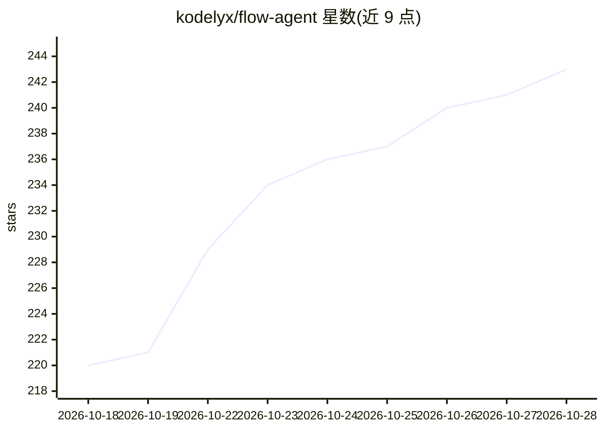

# kodelyx/flow-agent

⭐ 243 · JavaScript · 推送 2026-09-25 · [GitHub](https://github.com/kodelyx/flow-agent) · [官网](https://github.com/kodelyx/flow-agent) · 个人维护

**通过 CLI/REST/MCP 调用 Google Flow 生成 AI 图片与视频的本地服务**

本地服务器与 CLI 工具，经 Chrome 扩展 + WebSocket 桥接登录的 Google 账号调用 Google Flow，生成文本转图片（5 种宽高比、最多 4 变体）、文本转视频（4-10 秒、360p/720p）与图生视频。提供三种使用方式：终端 CLI、FastAPI REST 服务（含 OpenAI 兼容端点，改 base_url 即可替换 DALL-E 调用）、以及暴露 5 个工具的 MCP Server 供 Claude/Cursor 等 AI 助手调用。支持多账号积分池、SQLite 历史与余额统计。限制：需 Chrome 扩展保持 Flow 页面前台运行。

## 筛选速览

| 维度 | 判定 | 备注 |
|---|---|---|
| AI 角色 | `ai-native` | 本体是模型或模型工具 |
| 许可风险 | `none` | — |
| 部署形态 | `library` | 以包/库形式分发 |
| 模型依赖 | — | README 未给出锁定关系 |
| 硬件要求 | — | 无带数字的原话,不猜 |
| 安装摩擦 | `low` | 无编译、无系统依赖或容器化 |
| 成熟度 | — | 结构信号不足 |

## 能力要点

- 文本转图/文生视频/图生视频三类生成
- OpenAI 兼容端点（/v1/images/generations、/v1/chat/completions SSE）
- MCP Server 暴露 5 个工具供 Claude/Cursor/AGY 调用
- 多账号积分池、SQLite 历史与余额统计、flow doctor 自诊断

## 适用场景

- 在终端用一句话生成图片或视频
- 把现有 OpenAI SDK 代码的 base_url 改一行即切换到 Flow 生成
- 让 Claude/Cursor 等 AI 助手直接生成配图或视频片段
- 用 REST API 给任意应用接入图片/视频生成

## 场景标签

`图像生成` `视频生成` · 领域:内容生成

## 证据(README 行号)

> L3: **Generate AI images and videos from Google Flow — via CLI, REST API, or your AI assistant.**
> L19: Flow Agent is a **local server and CLI** that connects to Google Flow to generate high-quality AI images and videos
> L29: - 🖼️ **Text → Image** — aspect ratios: `1:1` `16:9` `9:16` `4:3` `3:4`, up to 4 variations at once
> L30: - 🎬 **Text → Video** — durations: `4s` `6s` `8s` `10s`, quality: `360p` / `720p`

## 星数曲线

2026-10-18 220 → 2026-10-28 243（+23）

---
*卡片 v1 · prompt 1.4 · 生成 2026-10-22 · 置信度 high · 依据 README sha `957cb0d5e16d` · [字段定义](../../DATASET.md)*
