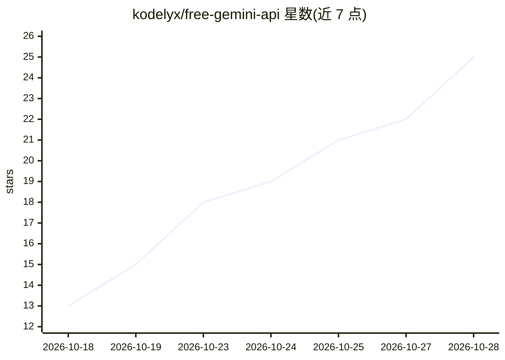

# kodelyx/free-gemini-api

⭐ 26 · Go · 推送 2026-10-14 · [GitHub](https://github.com/kodelyx/free-gemini-api) · [官网](https://github.com/kodelyx/free-gemini-api#readme) · 个人维护

**逆向 Google Gemini 网页协议的免费 OpenAI 兼容代理服务器**

用 Go 编写的本地代理引擎，通过逆向 Google 的 JSPB 扩展协议，把 Gemini 网页接口转换为 OpenAI 兼容的 /v1/chat/completions 端点，声称支持多个模型 ID 与高中低三档 thinking 控制。账号侧通过配套 Chrome 扩展自动发现本地服务器并同步会话 Cookie，支持 1–100+ 账号池负载均衡与限速冷却；使用 HTTP/3 QUIC 传输，SQLite 记录用量统计并可导出 Excel。运行方式为 go run 源码或 Docker Compose，依赖用户自己的 Google 登录态。

## 筛选速览

| 维度 | 判定 | 备注 |
|---|---|---|
| AI 角色 | `ai-ecosystem` | LLM/agent 周边工具 |
| 许可风险 | `none` | — |
| 部署形态 | `self-host` | docker 或自建部署 |
| 模型依赖 | — | README 未给出锁定关系 |
| 硬件要求 | — | 无带数字的原话,不猜 |
| 安装摩擦 | `low` | 无编译、无系统依赖或容器化 |
| 成熟度 | — | 结构信号不足 |

## 能力要点

- OpenAI 兼容 REST/流式端点，含多档 thinking 级别模型别名
- Chrome 扩展自动同步会话 Cookie 到本地账号池
- 多账号负载均衡与自动限速冷却
- SQLite 用量统计、JSON/Excel 导出与 MCP 服务器模式

## 适用场景

- 在 Cursor/Cline 等客户端中以 OpenAI 兼容接口调用 Gemini
- 多账号池化分摊请求负载
- 本地统计 token 用量并导出报表

## 场景标签

`模型网关` · 领域:Agent 开发

## 证据(README 行号)

> L15: Until now, Argon's thinking controls were locked behind Google's internal web interface. This repository reverse-en
> L125: |`POST`|`/v1/chat/completions`|OpenAI-compatible chat & streaming completions (Default: `gemini-3.8-flash`, Fronti

## 星数曲线

2026-10-18 13 → 2026-10-28 25（+12）

---
*卡片 v1 · prompt 1.4 · 生成 2026-10-27 · 置信度 high · 依据 README sha `0b7d9e194b6d` · [字段定义](../../DATASET.md)*
